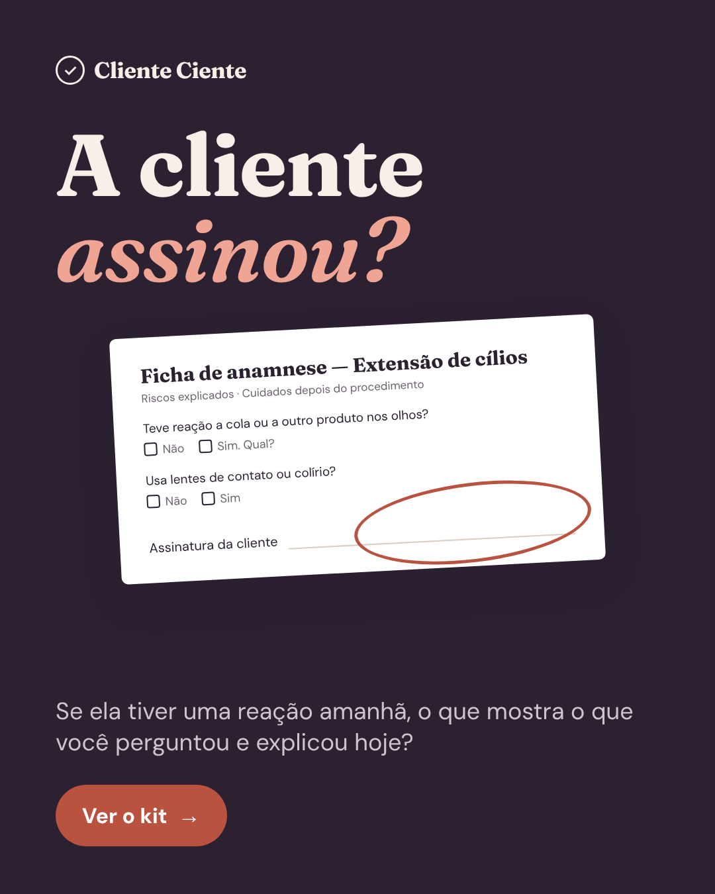
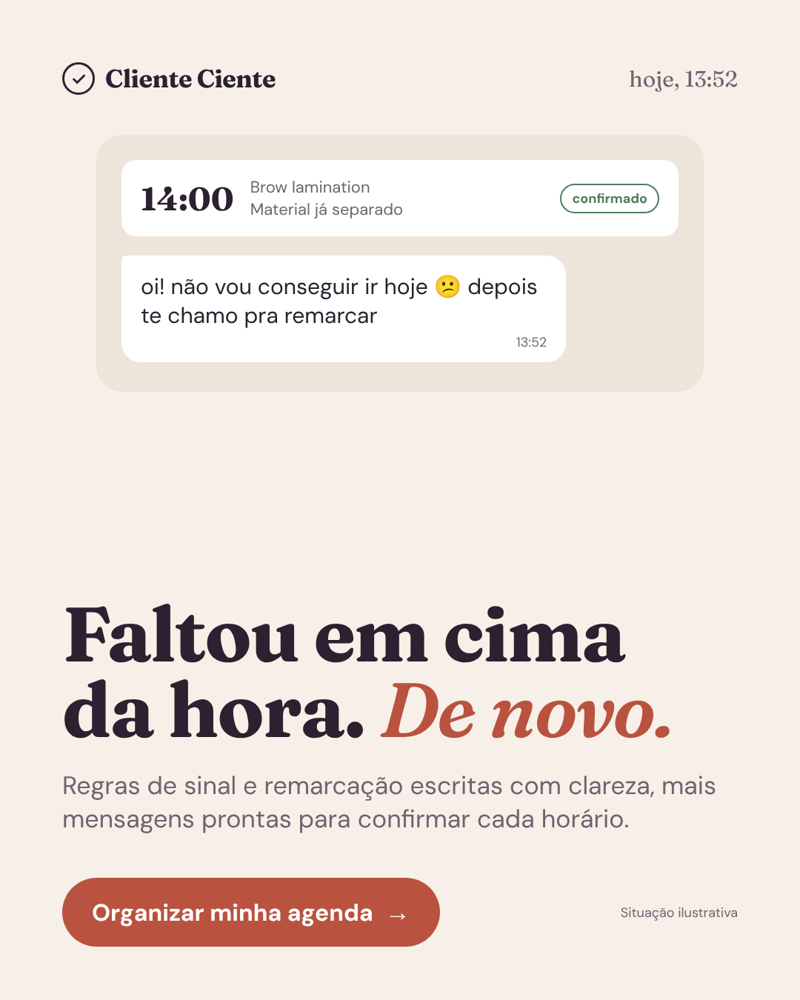
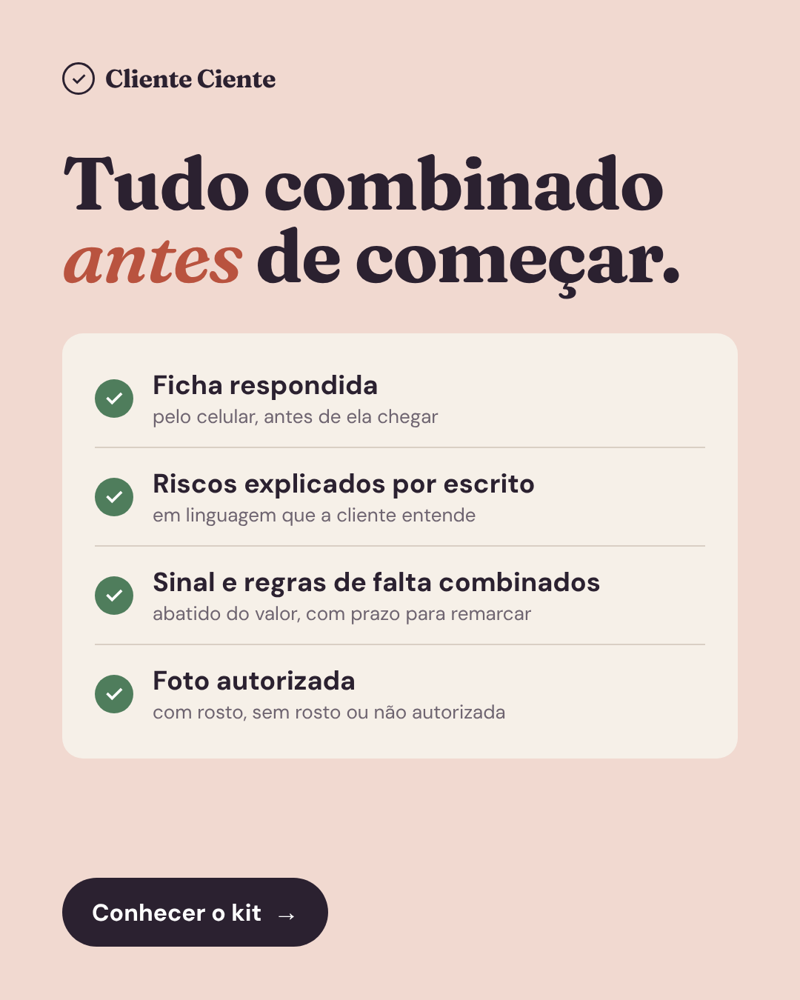
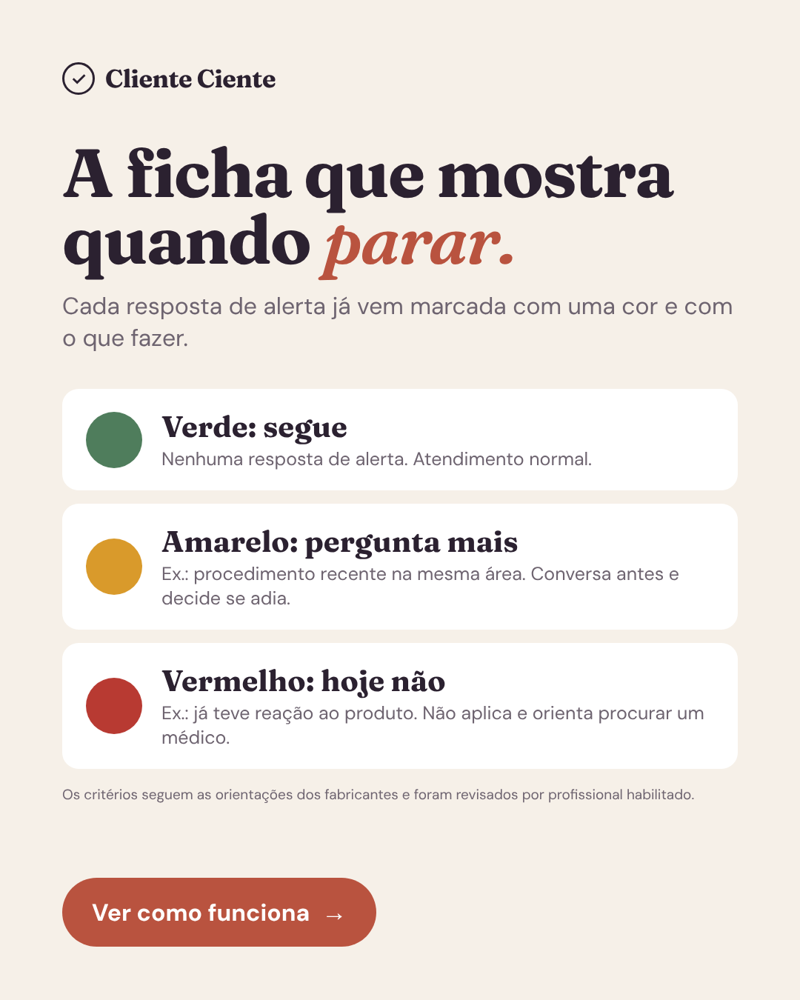
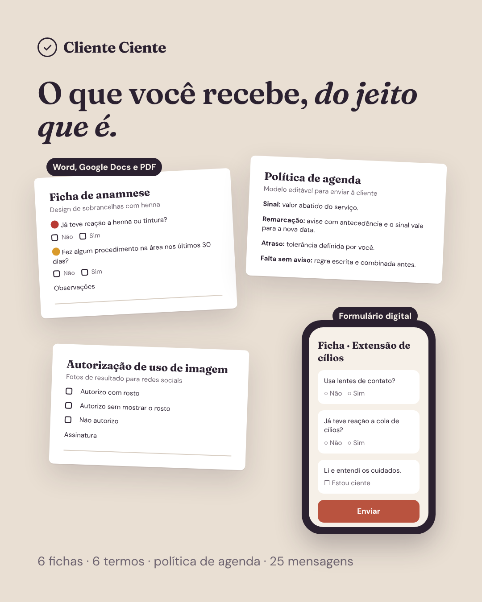
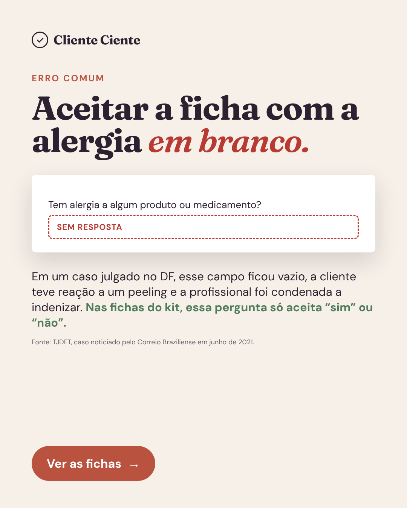
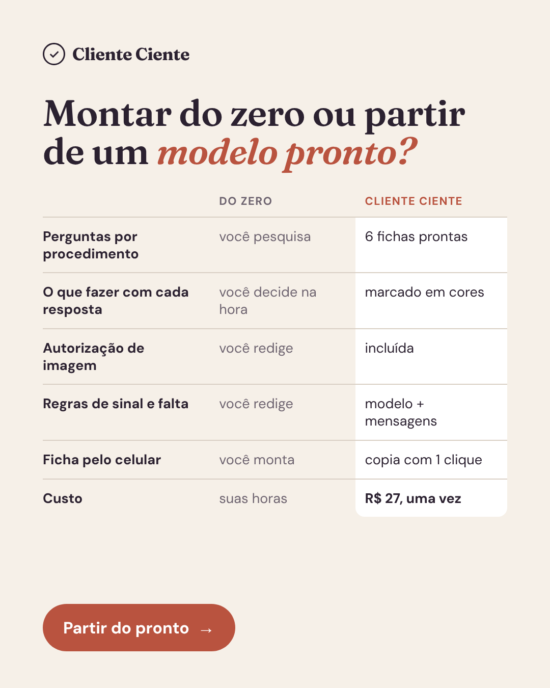
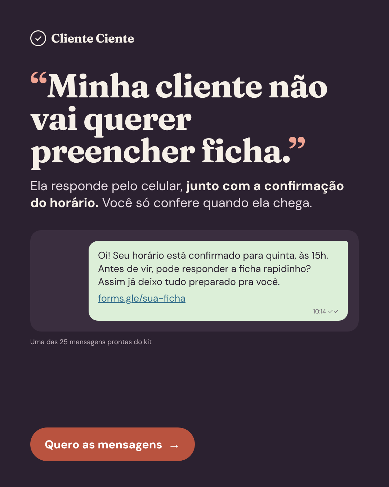
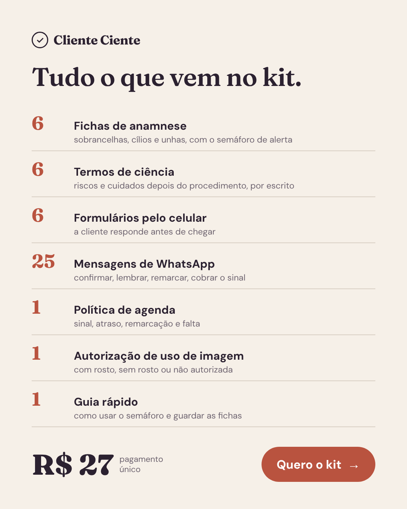
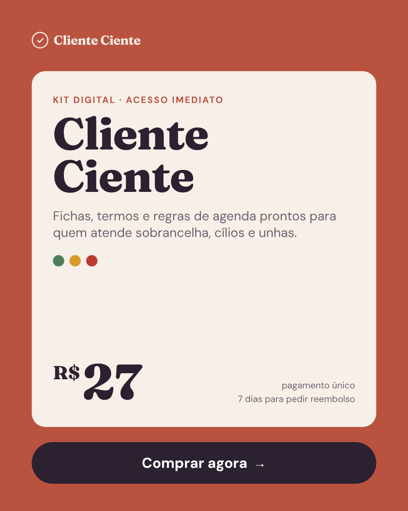

# Cliente Ciente: pesquisa, oferta e campanha de validação

Relatório da missão "encontrar um produto digital vencedor e montar uma operação low ticket".
Data da pesquisa: 23/10/2026. Mercado: Brasil.

> **Aviso principal.** O ambiente em que esta pesquisa foi feita não conseguiu abrir a Biblioteca de Anúncios da Meta.
> O acesso a `facebook.com`, `hotmart.com`, `kiwify.com.br`, `google.com` e até `wikipedia.org` foi recusado pela
> política de rede do ambiente, e a ferramenta de leitura de páginas também falhou. A única via que funcionou foi um
> buscador web, que devolve trechos indexados das páginas.
> Consequência: **nenhum anúncio, data de veiculação ou contagem de criativos deste relatório foi observado diretamente.**
> Onde o roteiro pedia esses dados, o relatório diz "não verificado" e indica como verificar
> (seção 2.4 e etapa 1 do plano de execução). Nenhum número de anúncios foi estimado ou inventado.

---

## 1. Resumo executivo

**O que foi feito.** Cerca de 35 buscas cobriram os mercados indicados (beleza, relacionamentos, carreira, marketing,
IA, finanças, saúde, habilidades profissionais, pequenos negócios). Ficaram cinco finalistas com sinais públicos de
oferta e demanda. Em todos, os sinais vêm do marketplace e de dados de mercado, não de anúncios.

**Conclusão honesta.** Nenhum dos cinco tem evidência publicitária verificada. Por isso **não existe um "vencedor
comprovado"**. Existe a alternativa com maior potencial de validação, que é a recomendada para teste:

> **Kits de documentos para profissionais da beleza** (fichas de anamnese, termos de consentimento, regras de agenda),
> nota 65/100. O segundo colocado ficou com 58.

Por que esse mercado:

- **Público grande e fácil de achar.** "Cabeleireiros, manicure e pedicure" é a atividade com mais MEIs no Brasil:
  1.051.403 registros até 31/05/2026 ([Sebrae/Receita Federal](https://datasebrae.com.br/wp-content/uploads/2025/02/RELATORIO-UNIVERSO-MEI-e-MPE-Maio-2026-Brasil-Nordeste-Bahia-e-Unidades-Regionais.pdf)).
  Fora desse CNAE ainda há designers de sobrancelha, lash designers e esteticistas.
- **Oferta já existe e é paga.** Há pelo menos oito kits independentes do tipo na Hotmart, um deles a R$ 109,90, e um
  gerador on-line que vende uma única ficha por R$ 29,90 (links na seção 3).
- **O problema tem custo concreto.** Há uma condenação após reação alérgica em que o campo de alergias da ficha ficou em
  branco ([Correio Braziliense](https://www.correiobraziliense.com.br/cidades-df/2021/06/amp/4934733-justica-determina-indenizacao-a-vitima-de-negligencia-em-procedimento-estetico.html)),
  uma condenação de salão por uso de imagem sem autorização ([Rota Jurídica](https://www.rotajuridica.com.br/salao-de-beleza-e-estudio-fotografico-sao-condenados-por-uso-indevido-de-imagem-de-modelo/)),
  e o prejuízo diário de clientes que faltam.
- **Cabe num anúncio estático.** Uma ficha, um termo assinado, uma mensagem de "não vou conseguir ir" são imagens que
  a profissional reconhece em um segundo.

**Oferta criada: Cliente Ciente.** Kit de fichas, termos e regras de agenda para quem atende sobrancelha, cílios e unhas.
O diferencial é o **semáforo da ficha**: cada resposta de alerta já vem marcada em verde (segue), amarelo (pergunta mais)
ou vermelho (hoje não). Vem junto com política de sinal e falta, 25 mensagens de WhatsApp e versão em formulário de
celular. Preço sugerido: R$ 27, com order bump de R$ 12,90 e upsell de R$ 37.

**Economia.** Com as taxas de plataforma tratadas como hipótese (8,99% + R$ 2,49), sobram R$ 20,46 por venda simples
antes da publicidade. Nos cenários com bump, upsell e reembolso, o CPA de equilíbrio fica entre R$ 19,71 e R$ 25,72.
A margem é apertada: o modelo depende do bump e de CPA abaixo de ~R$ 15 para dar lucro.

**Teste com R$ 100.** Com esse valor, o número esperado de vendas fica entre zero e três. O teste mede atenção e
intenção (CTR de saída, custo por visualização da página, inícios de checkout) e serve para escolher o ângulo, não para
provar lucratividade. A recomendação é testar quatro conceitos, não dez.

**O que foi entregue neste repositório:**

| Entrega | Onde |
|---|---|
| Este relatório (16 seções) | `cliente-ciente/RELATORIO.md` |
| 10 criativos em PNG, nos formatos 4:5, 1:1 e 9:16 | `cliente-ciente/criativos/png/` |
| Fonte editável dos criativos (HTML/CSS) e script de renderização | `cliente-ciente/criativos/src/`, `render.mjs` |
| Simulação financeira (script e resultado) | `cliente-ciente/financeiro/` |
| Landing page de teste (HTML estático) | `cliente-ciente/landing/index.html` |

**Antes de gastar o primeiro real:** confirmar manualmente os anúncios na Biblioteca (seção 2.4), produzir o kit de
verdade, revisar o conteúdo com profissional habilitado e com advogado, e confirmar as taxas da plataforma.

---

## 2. Metodologia de pesquisa

### 2.1 O que foi tentado

| Fonte | Resultado |
|---|---|
| Biblioteca de Anúncios da Meta (`facebook.com/ads/library`) | **Bloqueada** no ambiente (proxy recusou a conexão; a ferramenta de leitura de páginas não resolveu o domínio) |
| API da Biblioteca (`graph.facebook.com/ads_archive`) | Bloqueada, e exigiria token de acesso |
| Páginas da Hotmart, Kiwify e Google | Bloqueadas para leitura direta |
| Buscador web (trechos indexados) | **Funcionou.** Todas as evidências deste relatório vêm daqui |
| Ferramentas de "espionagem" de ofertas (Adsparo, AdEscala, SpyROI, ofertasescaladas.com) | Só a página de apresentação aparece no buscador. Os exemplos exibidos em ofertasescaladas.com ("método-conquista.com, 120 anúncios") não têm fonte nem metodologia e **não foram usados** |

### 2.2 Como os mercados foram varridos

Para cada mercado da lista do roteiro, a pesquisa procurou:

1. **Oferta paga existente:** páginas de produto no marketplace da Hotmart, Kiwify, Gumroad e Mercado Livre.
2. **Densidade de concorrência:** quantos vendedores independentes oferecem a mesma coisa. Muitos vendedores indicam
   que alguém compra, mas também indicam disputa. É sinal de oferta, não de vendas.
3. **Tamanho e acessibilidade do público:** dados oficiais (Sebrae/Receita, conselhos de classe).
4. **Custo do problema:** decisões judiciais, normas e dados de prejuízo.
5. **Alternativas gratuitas:** modelos grátis do Canva, planilhas de bancos e portais.

### 2.3 Classificação das evidências

Cada afirmação deste relatório se encaixa em uma destas categorias:

- **[Observado]** Dado lido diretamente em uma fonte (trecho indexado de página de produto, relatório oficial, notícia).
- **[Complementar]** Evidência pública indireta de demanda (tamanho do público, decisões judiciais, preço de concorrente).
- **[Inferência]** Conclusão minha a partir das evidências, com a justificativa ao lado.
- **[Não verificável aqui]** Dado que a pesquisa não conseguiu obter. Inclui **todos** os dados de anúncios: datas de
  início, quantidade de criativos, situação ativa ou inativa.

Mesmo com acesso total, a Biblioteca não mostra gasto, alcance, vendas, ROAS nem conversão de anúncios comerciais comuns
([TrendTrack](https://www.trendtrack.io/pt/blog-post/facebook-ad-library-definicao-e-guia-2026),
[blabla.ai](https://blabla.ai/pt-br/blog/facebook-ads-library)). O tempo de veiculação é só um indício.

### 2.4 Protocolo para completar a verificação de anúncios (fazer antes de investir)

Abra cada link abaixo num navegador comum (país = Brasil, anúncios ativos) e preencha a tabela.

| Termo | Link de busca |
|---|---|
| ficha de anamnese | <https://www.facebook.com/ads/library/?active_status=active&ad_type=all&country=BR&q=ficha%20de%20anamnese&search_type=keyword_unordered> |
| termo de consentimento estética | <https://www.facebook.com/ads/library/?active_status=active&ad_type=all&country=BR&q=termo%20de%20consentimento%20est%C3%A9tica&search_type=keyword_unordered> |
| kit esteticista documentos | <https://www.facebook.com/ads/library/?active_status=active&ad_type=all&country=BR&q=kit%20esteticista&search_type=keyword_unordered> |
| lash designer kit | <https://www.facebook.com/ads/library/?active_status=active&ad_type=all&country=BR&q=lash%20designer%20kit&search_type=keyword_unordered> |
| pack canva lash | <https://www.facebook.com/ads/library/?active_status=active&ad_type=all&country=BR&q=pack%20canva%20lash&search_type=keyword_unordered> |
| treinamentos NR editáveis | <https://www.facebook.com/ads/library/?active_status=active&ad_type=all&country=BR&q=treinamentos%20NR%20edit%C3%A1veis&search_type=keyword_unordered> |
| baralho terapêutico | <https://www.facebook.com/ads/library/?active_status=active&ad_type=all&country=BR&q=baralho%20terap%C3%AAutico&search_type=keyword_unordered> |
| planilha controle financeiro | <https://www.facebook.com/ads/library/?active_status=active&ad_type=all&country=BR&q=planilha%20controle%20financeiro&search_type=keyword_unordered> |

Para cada anunciante relevante, anote: nome da página, link do anúncio, data de início, quantos anúncios ativos levam à
mesma página de vendas e quantas variações de imagem e título existem.

**Regra de decisão sugerida para o finalista escolhido:** seguir com o teste se aparecerem **pelo menos três
anunciantes diferentes**, cada um com anúncios ativos há 30 dias ou mais levando a uma página de vendas de documentos
para profissionais da beleza. Com um ou nenhum, a demanda paga continua sem prova: o teste ainda pode ser feito, mas o
orçamento deve ser tratado como pesquisa e não como lançamento. Os sinais de 5 ou mais anúncios ativos e 30 dias ou mais
de veiculação são os mesmos usados por ferramentas de mineração de ofertas
([exemplo](https://github.com/GabrielDEVX/Minerador-Claude-Skill-LowTicket-Nutra)).

### 2.5 Candidatos investigados e descartados antes da final

| Candidato | Por que saiu |
|---|---|
| Packs de prompts de IA por profissão ([Hotmart, 200+ prompts por R$ 27](https://hotmart.com/pt-br/marketplace/produtos/200-prompts-chatgpt-para-vendedores-mercado-livre-shopee-e-hotmart-titulos-descricoes-anuncios-e-atendimento/W104058599X); [G-Talent, kit para psicólogos](https://www.g-talent.net/products/ia-para-psicologos-kit-profesional)) | Barreira de entrada mínima, conteúdo copiável em minutos e muito material grátis ([exemplo](https://viniensina.com.br/prompts-chatgpt-vendas/)). Difícil sustentar diferencial |
| Prompts de "ensaio fotográfico com IA" ([BNews](https://www.bnewssaopaulo.com.br/noticias/entretenimento/veja-os-prompts-para-criar-seu-ensaio-fotografico-de-estudio-com-o-gemini.html), [treinamentosaf](https://treinamentosaf.com.br/prompts-gemini-para-ensaio-fotografico-brasil-47-prompts-ia/)) | Moda passageira, prompts distribuídos de graça pela imprensa, risco com uso de imagem de terceiros |
| Mapas mentais para concurso ([Nova Concursos](https://www.novaconcursos.com.br/mapas-mentais/mapas-mentais?p=3)) | Mercado dominado por editoras grandes com catálogo por cargo; difícil competir sem autoria especializada |
| Kits de currículo ([Hotmart](https://hotmart.com/pt-br/marketplace/produtos/kit-inteligente-de-curriculo-carta-de-apresentacao-linkedin-perfeito/A99309753B)) | Alternativas gratuitas fortes ([Zety](https://zety.com/br/modelos-de-curriculo), Canva) e público com pouca renda disponível no momento da compra |
| Contratos para fotógrafos ([Hotmart](https://hotmart.com/pt-br/marketplace/produtos/contrato-completo-para-fotografos-f7vun/X81586015G)) | Público menor; a mesma lógica funciona melhor no público de beleza, que é muito maior |
| Kit de riscos psicossociais da NR-1 | Tema quente desde a vigência em 26/05/2026 ([FINDES](https://findes.com.br/wp-content/uploads/2026/03/Informe-Estrategico-–-MTE-lanca-Manual-de-Interpretacao-e-Aplicacao-do-Capitulo-1.5-da-NR-1.pdf)), mas nenhuma oferta low ticket foi encontrada e o risco de erro técnico é alto |
| Categorias proibidas pelo roteiro (infantil, culinária, renda extra genérica) | Excluídas desde o início. O projeto anterior deste repositório (`panela-no-lucro`, nicho de comida) não foi reaproveitado por esse motivo |

---

## 3. Cinco produtos identificados e suas evidências

Os cinco são **categorias de oferta**, cada uma com vários vendedores, e não um produto único de um anunciante. Foi a
forma honesta de trabalhar sem a Biblioteca: um único produto escolhido às cegas daria uma falsa precisão.

### 3.1 Finalista A: Kits de documentos para profissionais de estética e beleza

**A. Identificação**

- **Ofertas encontradas [Observado]:**
  - [Pacote de documentos personalizáveis para profissionais de estética e saúde](https://hotmart.com/pt-br/marketplace/produtos/pacote-de-documentos-personalizaveis-para-profissionais-de-estetica-saude/M93722750T) (mais de 100 documentos, contratos para mais de 36 procedimentos)
  - [Kit Essencial para Esteticista](https://hotmart.com/pt-br/marketplace/produtos/kit-essencial-para-esteticista-pop-termos-contratos-anamnese-manual-de-rotinas-recomendacoes-biosseguranca-ficha-de-controle-de-sessao/A76975049U) (mais de 50 arquivos, mais de 25 procedimentos)
  - [Kit Editável Esteticista de Sucesso](https://hotmart.com/pt-br/marketplace/produtos/kit-editavel-esteticista-de-sucesso-pop-termos-contratos-anamnese-manual-de-rotinas-recomendacoes-biosseguranca-ficha-de-controle-de-sessao/O76641982J)
  - [Fichas para Estética: anamnese, POP, contrato, termo e guia](https://hotmart.com/pt-br/marketplace/produtos/fichas-para-estetica-fichas-anamnese-pop-contrato-de-prestacao-de-servicos-termo-de-consentimento-guia-resumido/V87667405O) (**R$ 109,90**, mais de 130 arquivos)
  - [Pack Canva Fichas de Anamnese](https://hotmart.com/pt-br/marketplace/produtos/fichas-de-anamnese/N77996234G) (inclui brow lamination e micropigmentação)
  - [Kit Profissional de Fichas para Intradermoterapia](https://hotmart.com/pt-br/marketplace/produtos/kit-profissional-de-fichas-para-intradermoterapia/P101779881A)
  - [Kit Gold de Formulários para terapeutas](https://hotmart.com/pt-br/marketplace/produtos/kit-documentos-para-terapeutas/I85584149S)
  - [Kit de fichas odontológicas](https://hotmart.com/pt-br/marketplace/produtos/kit-fichas-odontologicas-fichas-anamenese-plano-de-tratamento-tcle-cuidados-pos-pronto-e-editavel/S101971861K) (mesma lógica, outra profissão)
  - Fora de marketplace: [GeraContratos](https://geracontratos.com.br/ficha-de-anamnese/estetica) vende uma ficha de estética por **R$ 29,90** (de R$ 49,90)
- **Nicho / subnicho:** beleza e estética / gestão e segurança documental de atendimentos.
- **Público:** profissionais autônomas e MEIs de sobrancelha, cílios, unhas e estética facial e corporal.
- **Problema prometido:** atender com documentação profissional, registrar consentimento e reduzir risco.
- **Mercado:** Brasil.

**B. Evidências publicitárias**

- Links para anúncios, data de início, situação, quantidade de variações, ângulos e renovação criativa: **[Não verificável aqui]**.
- Limitação: as páginas de produto não informam quantas vendas fizeram. Sem a Biblioteca, não há como saber quais desses
  vendedores anunciam.

**C. Análise da oferta**

- **Formato:** arquivos Word, PDF e Canva editáveis, entregues na área de membros. [Observado]
- **Preço público:** R$ 109,90 no kit grande; R$ 29,90 por ficha avulsa no gerador. Os demais não mostraram preço no trecho indexado.
- **Promessa central:** "documentação completa e profissional" com volume (100+, 130+ arquivos). [Observado]
- **Mecanismo:** quase todos competem por volume de arquivos. Nenhum trecho encontrado oferece critério de decisão sobre
  as respostas ou regras de agenda. [Inferência a partir dos trechos lidos]
- **Objeções que as páginas tentam superar:** edição fácil, personalização com a marca, acesso vitalício. [Observado]
- **Complementos possíveis:** POPs para vigilância sanitária, planilhas de agenda, packs de artes.
- **Facilidade de criar algo original:** alta. O formato é simples, e o espaço de diferenciação (decisão sobre respostas,
  agenda, formulário digital) não aparece ocupado nos trechos vistos.

**D. Análise de mercado**

- **Demanda provável: alta (confiança média).** Público de mais de 1 milhão de MEIs só no CNAE principal
  ([Sebrae/Receita](https://datasebrae.com.br/wp-content/uploads/2025/02/RELATORIO-UNIVERSO-MEI-e-MPE-Maio-2026-Brasil-Nordeste-Bahia-e-Unidades-Regionais.pdf)).
  Um guia do setor afirma que a vigilância sanitária costuma exigir POP e cita a ficha de anamnese entre os documentos
  ([Boa Conta](https://www.boaconta.com.br/blog/pop-lash-designer-extensao-cilios/)). Isso é uma fonte comercial, não a norma.
- **Concorrência:** moderada no pago, forte no gratuito: o Canva tem [modelos grátis de ficha de anamnese](https://www.canva.com/pt_br/modelos/s/ficha-de-anamnese/).
- **Comunicação em anúncio estático:** muito boa. O documento é o próprio produto e é visual.
- **Venda por impulso:** média para alta a R$ 27. Ferramenta de trabalho barata, comprada para "resolver isso hoje".
- **Diferenciação:** alta (semáforo, agenda, formulário digital).
- **Riscos:** (1) conteúdo errado gera dano real, então exige revisão técnica e jurídica; (2) não se pode prometer
  "proteção jurídica", porque o termo não isenta responsabilidade ([Garrastazu Advogados](https://www.garrastazu.adv.br/termo-de-consentimento-livre-e-esclarecido-em-procedimentos-esteticos-por-que-a-assinatura-nao-elimina-a-responsabilidade-da-clinica-));
  (3) dados de saúde são dados sensíveis na LGPD ([Medicina S/A](https://medicinasa.com.br/dados-sensiveis-saude/)).
- **Margem para publicidade:** apertada a R$ 27 e confortável a R$ 37 ou mais (seção 15).

**E. Grau de confiança**

| Conclusão | Confiança |
|---|---|
| Existe oferta paga ativa no marketplace | Alta |
| O público é grande e alcançável por segmentação de interesse | Alta |
| Há anunciantes investindo de forma contínua | **Baixa** (não verificado) |
| Há espaço para diferenciação | Média |

### 3.2 Finalista B: Packs de artes no Canva para profissionais de beleza

**A. Identificação**

- **Ofertas [Observado]:** [Canva para Design de Sobrancelhas e Lash](https://hotmart.com/pt-br/marketplace/produtos/canvadesignerdesobrancelhaelash/N62993545J) (mais de 200 artes e videoaulas),
  [Pack Canva Lash Design](https://hotmart.com/pt-br/marketplace/produtos/pack-canva-lash-design-extensao-de-cilios/H70778152K) (70+),
  [Pack Lash Design Lucrativo](https://hotmart.com/pt-br/marketplace/produtos/pack-lash-design-lucrativo/S75836988B) (50 feed + 50 stories + 20 capas),
  [Pack Canva 100% editável Lash](https://hotmart.com/pt-br/marketplace/produtos/pack-canva-100-editavel-extensao-de-cilios-lash-designer/C76870557H) (80),
  [Pack 28 artes Sobrancelhas](https://hotmart.com/pt-br/marketplace/produtos/pack-28-artes-para-feed-canva-editavel-designer-de-sobrancelhas-iniciante/S104431559R),
  [Pack de Artes Lash 1](https://hotmart.com/pt-br/marketplace/produtos/pack-de-artes-lash-1/O66465133K),
  [Pack Salão de Beleza Chic](https://hotmart.com/pt-br/marketplace/produtos/pack-canva-editavel-estetica-beauty-chic-50-templates/D58100308C).
  Pack de manicure no [Mercado Livre](https://lista.mercadolivre.com.br/pack-designer) por **R$ 24,90**.
- **Nicho:** beleza / marketing para profissionais.
- **Público:** as mesmas profissionais do finalista A.
- **Problema:** falta de tempo e de habilidade para postar com frequência e boa aparência.

**B. Evidências publicitárias:** **[Não verificável aqui]**.

**C. Análise da oferta**

- Formato: modelos Canva por link. Preço visível só no Mercado Livre (R$ 24,90).
- Promessa: perfil profissional sem designer. Mecanismo: quantidade de artes.
- Objeções tratadas: funciona no Canva gratuito, acesso vitalício.
- Upsells prováveis: legendas, videoaulas de Instagram.
- Criar algo original: fácil de produzir, difícil de diferenciar.

**D. Análise de mercado**

- Demanda: média para alta (muitos vendedores atendendo o mesmo público).
- Concorrência: **saturada**, e o próprio Canva oferece [modelos grátis para lash](https://www.canva.com/pt_pt/modelos/s/lashes/).
- Anúncio estático: excelente, porque o produto é visual.
- Impulso: alto. Diferenciação: baixa.
- Riscos: guerra de preço e "mais artes que o concorrente"; promessas de "atrair clientes" difíceis de sustentar.
- Margem: semelhante ao A, com conversão provavelmente mais disputada.

**E. Confiança:** oferta existe (alta); diferenciação viável (baixa); anúncios (baixa, não verificado).

### 3.3 Finalista C: Treinamentos de NR editáveis para técnicos de segurança do trabalho

**A. Identificação**

- **Ofertas [Observado]:** [Kit Premium com 50 treinamentos das NRs](https://hotmart.com/pt-br/marketplace/produtos/kit-premium-de-treinamentos-das-nrs/Q100083171S),
  [Apresentação NR-35 com 120+ slides](https://hotmart.com/pt-br/marketplace/produtos/apresentacao-profissional-nr-35-trabalho-em-altura/I101914310Q),
  [NR-10 SEP pronto para instrutores](https://hotmart.com/pt-br/marketplace/produtos/treinamento-nr-10-sep-pronto-para-instrutores-o-curso-completo-em-maos-para-voce-ministrar-hoje-mesmo-editavel/L101767259P),
  [Treinamentos editáveis NR-05 CIPA](https://hotmart.com/pt-br/marketplace/produtos/treinamentos-editaveis-nr-05-cipa/W88909966F),
  [Certificados NR editáveis](https://hotmart.com/pt-br/marketplace/produtos/modelos-de-certificados-nr-editaveis-profissional-de-sst/F100791361S),
  [NR-10 SEP em slides](https://hotmart.com/pt-br/marketplace/produtos/curso-de-nr10-sep-em-slides/L90161346K),
  [Metodologias para treinamentos de SST](https://hotmart.com/pt-br/marketplace/produtos/metodologias-para-treinamentos-de-seguranca-do-trabalho/B88686172X).
- **Nicho:** carreira e habilidades profissionais / saúde e segurança do trabalho.
- **Público:** técnicos de segurança, engenheiros, consultores, RH e CIPA.
- **Problema:** montar treinamentos obrigatórios exige muitas horas.

**B. Evidências publicitárias:** **[Não verificável aqui]**.

**C. Análise da oferta**

- Formato: PowerPoint editável, PDF e certificados. Preço não apareceu nos trechos.
- Promessa: "curso pronto para ministrar hoje". Mecanismo: conteúdo técnico já organizado.
- Objeções tratadas: editável, com a logo do cliente.
- Upsells: certificados, listas de presença, avaliações.
- Criar algo original: **difícil.** Exige especialista em SST e atualização constante: a NR-1 mudou em 2026
  ([Barbieri Advogados](https://www.barbieriadvogados.com/nr-1-e-riscos-psicossociais/)), e há relato não confirmado de
  que o treinamento da NR-35 passou a ser só presencial ([Engehall](https://engehall.com.br/curso-nr-35-guia-de-contratacao/)).

**D. Análise de mercado**

- Demanda: média, mas com intenção de compra forte (o técnico ganha dinheiro com o treinamento).
- Concorrência: moderada. Tamanho do público: **desconhecido**, porque não há número oficial publicado de técnicos
  registrados (a busca não encontrou).
- Anúncio estático: médio (conteúdo técnico, pouco visual).
- Impulso: médio. Diferenciação: média.
- Riscos: material técnico errado expõe trabalhadores a acidentes; responsabilidade alta para quem vende sem formação na área.
- Margem: boa (ticket pode ser maior), mas o público é menor e mais caro de atingir. [Inferência]

**E. Confiança:** oferta existe (alta); viabilidade para quem não é da área (baixa); anúncios (baixa).

### 3.4 Finalista D: Baralhos e materiais terapêuticos para psicólogos (uso com adultos)

**A. Identificação**

- **Ofertas [Observado]:** [Baralho de Aceitação (ACT), 24 cartas](https://hotmart.com/pt-br/marketplace/produtos/baralho-de-aceitacao-entre-recursos/B99497841A),
  [Baralho Mapas Internos, 200 cartas](https://hotmart.com/pt-br/marketplace/produtos/baralho-mapas-mentais-para-adultos/H104138352C),
  [Kit Terapêutico TCC: Ansiedade e Pensamentos](https://hotmart.com/pt-br/marketplace/produtos/kit-terapeutico-tcc-ansiedade-e-pensamentos/I104833476D),
  [Baralho das Distorções Cognitivas, 26 cartas](https://hotmart.com/pt-br/marketplace/produtos/baralho-das-distorcoes-cognitivas/H101309041K),
  [Baralho de Habilidades Sociais](https://hotmart.com/pt-br/marketplace/produtos/baralho-terapeutico-habilidades-sociais/U104623917K).
  Referência física: [Baralho do Modelo Cognitivo, Martins Fontes, **R$ 237**](https://www.martinsfontespaulista.com.br/baralho-do-modelo-cognitivo-para-adultos--psicoeducacao-dos-pensamentos--sentimentos-e-comportamento-878097/p).
- **Nicho:** saúde mental (profissional) / recursos clínicos.
- **Público:** psicólogos clínicos. O CFP tem mais de 600 mil inscritos, segundo [Agora RN](https://agorarn.com.br/saude/nordeste-norte-piores-acessos-psicologos-sus-caps/), que cita o conselho.
- **Problema:** tornar a sessão mais estruturada e a psicoeducação mais concreta.

**B. Evidências publicitárias:** **[Não verificável aqui]**.

**C. Análise da oferta**

- Formato: PDF para imprimir ou usar em tela. Preço não apareceu nos trechos; a versão física custa R$ 237.
- Promessa: recurso prático para sessões. Mecanismo: cartas por tema ou técnica.
- Objeções: base teórica e bibliografia citada.
- Upsells: outros baralhos e manuais.
- Criar algo original: **exige autoria de psicólogo** com formação na abordagem. Não é viável para quem não é da área.

**D. Análise de mercado**

- Demanda: média (público grande, mas compra por interesse, não por urgência).
- Concorrência: moderada, com editoras de peso no físico.
- Anúncio estático: bom (as cartas são visuais).
- Impulso: médio. Diferenciação: média.
- Riscos: ética profissional e regras de publicidade em saúde; anúncios sobre ansiedade esbarram na política de
  atributos pessoais da Meta ([ValorFinal](https://valorfinal.com.br/cursos/trafego-pago/politicas-bloqueios-e-anuncios-seguros/atributos-pessoais)).
- Margem: boa pela âncora de R$ 237 do físico.

**E. Confiança:** oferta existe (alta); viabilidade sem psicólogo autor (baixa); anúncios (baixa).

### 3.5 Finalista E: Planilhas de controle financeiro pessoal e de casal

**A. Identificação**

- **Ofertas [Observado]:** [Planilha de controle financeiro pessoal simples e prática](https://hotmart.com/pt-br/marketplace/produtos/planilha-de-controle-financeiro-pessoal-simples-e-pratica/F100975098E),
  [Planilha + guia de controle financeiro](https://hotmart.com/pt-br/marketplace/produtos/planilha-de-controle-financeiro-pessoal-guia-de-controle-financeiro/Q101458848G),
  [Controle financeiro pessoal](https://hotmart.com/pt-br/marketplace/produtos/controle-financeiro-pessoal-10/A55883218D),
  [Planilha financeira do Casalzão](https://hotmart.com/pt-br/marketplace/produtos/planilha-financeira-do-casalzao-controle-de-gastos-inteligente-por-mes/J99916561I).
  O Mercado Livre listou uma planilha de controle financeiro entre os mais vendidos de software de escritório
  ([blog Mercado Livre](https://www.mercadolivre.com.br/blog/mais-vendidos/software-escritorio)).
- **Nicho:** finanças pessoais.
- **Público:** adultos e casais que querem organizar gastos.
- **Problema:** não saber para onde o dinheiro vai.

**B. Evidências publicitárias:** **[Não verificável aqui]**. Um blog relata uma planilha para MEI a R$ 47 com 54 vendas
em 60 dias ([FreelaSemCrise](https://www.freelasemcrise.com.br/blog/vender-infoprodutos-como-comecar)). É um relato
isolado e não verificado.

**C. Análise da oferta**

- Formato: Excel ou Google Sheets com painel. Preço não apareceu nos trechos.
- Promessa: controle simples e gráficos automáticos. Mecanismo: painel visual.
- Objeções: facilidade de uso.
- Upsells: planilha de dívidas, de metas, de investimentos.
- Criar algo original: fácil, mas difícil de superar o grátis.

**D. Análise de mercado**

- Demanda: alta por informação, **baixa disposição a pagar**: há planilhas grátis do [InfoMoney](https://www.infomoney.com.br/?p=2751887),
  de bancos e dos apps de controle de gastos.
- Concorrência: saturada.
- Anúncio estático: médio.
- Impulso: médio. Diferenciação: baixa.
- Riscos: política da Meta para finanças e atributos pessoais (não se pode insinuar que a pessoa está endividada,
  [ValorFinal](https://valorfinal.com.br/cursos/trafego-pago/politicas-bloqueios-e-anuncios-seguros/atributos-pessoais)).
- Margem: baixa, porque a conversão tende a cair diante do gratuito. [Inferência]

**E. Confiança:** oferta existe (alta); disposição a pagar (baixa); anúncios (baixa).

---

## 4. Tabela comparativa e ranking de 0 a 100

**Leitura do critério de continuidade publicitária (20 pontos):** como nenhum anúncio foi observado, nenhum finalista
passou de 5. As notas de 4 a 5 refletem só um sinal indireto: vários vendedores independentes oferecendo o mesmo tipo de
produto há tempo suficiente para estarem indexados. Se a verificação manual (seção 2.4) confirmar anunciantes ativos há
mais de 30 dias, esse critério deve ser refeito.

| Critério (peso) | A. Docs beleza | B. Canva beleza | C. NR para TST | D. Baralhos psico | E. Planilha finanças |
|---|---:|---:|---:|---:|---:|
| Continuidade publicitária (20) | 5 | 5 | 4 | 4 | 5 |
| Evidências complementares de demanda (20) | 15 | 13 | 12 | 13 | 12 |
| Força do problema e intenção de compra (15) | 12 | 8 | 13 | 9 | 10 |
| Conversão por anúncio estático (15) | 12 | 13 | 9 | 11 | 10 |
| Viabilidade econômica low ticket (15) | 10 | 10 | 12 | 11 | 7 |
| Diferenciação e espaço competitivo (10) | 7 | 3 | 6 | 6 | 3 |
| Entrega e satisfação do comprador (5) | 4 | 5 | 2 | 2 | 5 |
| **Total (100)** | **65** | **57** | **58** | **56** | **52** |

**Ranking**

1. **A. Kits de documentos para profissionais da beleza: 65.** Maior público mensurável, problema com custo concreto
   (indenização, horário perdido), produto visual e espaço livre para um mecanismo diferente. Perde pontos por não ter
   anúncios verificados e por exigir revisão técnica e jurídica.
2. **C. Treinamentos de NR: 58.** Melhor intenção de compra e ticket potencial maior, mas o público não tem tamanho
   conhecido, o anúncio é pouco visual e a entrega exige especialista. Errar aqui pode machucar alguém.
3. **B. Packs Canva para beleza: 57.** Ótimo para anúncio estático e fácil de entregar, mas saturado e concorrendo com
   modelos gratuitos do próprio Canva.
4. **D. Baralhos para psicólogos: 56.** Boa âncora de preço, mas só é viável com autoria de psicólogo e tem restrições de
   publicidade em saúde mental.
5. **E. Planilhas de finanças pessoais: 52.** Demanda alta por informação e baixa disposição a pagar; concorre com o grátis
   de bancos, portais e apps.

---

## 5. Justificativa da escolha

**Declaração obrigatória:** nenhum dos cinco tem evidência publicitária suficiente para ser chamado de vencedor
comprovado. O finalista A é **a alternativa com maior potencial de validação**, não um produto validado.

Por que A, e não C (o segundo):

| Critério do roteiro | A. Docs beleza | C. NR |
|---|---|---|
| Demanda plausível e verificável | 1,05 mi MEIs no CNAE principal (oficial) | Tamanho do público desconhecido |
| Problema que motiva compra | Indenização, uso de imagem, horário perdido | Horas de preparo de aula |
| Explicável em um anúncio | "A cliente assinou?" | Exige explicar a norma |
| Diferenciação possível | Semáforo, agenda e formulário: não vistos nos concorrentes | Conteúdo técnico parecido entre vendedores |
| Preço acessível | R$ 27 cabe como compra de impulso | Mercado aceita ticket maior |
| Margem para anúncios | Apertada a R$ 27, melhora com bump e upsell | Melhor |
| Facilidade de criar e entregar | Documentos simples, com revisão profissional | Exige especialista em SST |
| Criativos estáticos convincentes | Muito bons (documento, conversa, semáforo) | Fracos |

**Riscos aceitos conscientemente:**

1. A margem a R$ 27 é estreita. Mitigação: bump, upsell e teste de preço a R$ 37.
2. O conteúdo precisa de revisão por profissional habilitado e por advogado antes da venda.
3. Concorrência gratuita (Canva). O diferencial precisa ser visível no anúncio, por isso o semáforo virou o mecanismo central.
4. A demanda paga continua sem prova até a verificação manual dos anúncios e o primeiro teste.

**Subnicho escolhido:** sobrancelha, cílios e unhas. São procedimentos com produtos químicos ou adesivos e alto volume de
atendimentos, feitos em geral por autônomas, sem a carga regulatória de procedimentos invasivos (peeling, injetáveis,
micropigmentação), que ficaram de fora de propósito.

---

## 6. Definição da oferta original

| # | Item | Definição |
|---|---|---|
| 1 | **Nome** | **Cliente Ciente.** Curto, rima, fácil de falar e já diz o resultado: a cliente sabe o que vai acontecer e concordou. Antes de registrar, consultar o [INPI](https://busca.inpi.gov.br/); a busca web não encontrou marca igual |
| 2 | **Nicho / subnicho** | Beleza / documentação e regras de atendimento para sobrancelha, cílios e unhas |
| 3 | **Compradora ideal** | Profissional autônoma ou com estúdio pequeno, de 22 a 45 anos, atende de 15 a 60 clientes por semana, agenda pelo WhatsApp, posta resultados no Instagram, usa ficha improvisada ou nenhuma, já levou falta em cima da hora e já teve uma cliente que reclamou de reação ou de foto postada |
| 4 | **Problema central** | Ela atende sem nada combinado por escrito: não sabe quando deve recusar um atendimento, não tem prova do que explicou, posta fotos sem autorização registrada e perde horários com faltas porque as regras de sinal e remarcação nunca foram claras |
| 5 | **Transformação** | De "vai dar certo" para "está combinado": cada cliente responde a ficha antes de chegar, as respostas de alerta mostram o que fazer, os riscos e cuidados estão por escrito e assinados, e as regras da agenda foram enviadas antes do primeiro horário |
| 6 | **Conteúdo exato** | Ver tabela 6.1 |
| 7 | **Entrega** | Área de membros da plataforma de pagamento. Arquivos em Word (.docx), Google Docs (link "fazer uma cópia") e PDF para imprimir. Formulários em Google Forms (link "fazer uma cópia"). Acesso imediato |
| 8 | **Diferencial real** | Os concorrentes vistos competem por volume (100+, 130+ arquivos). O Cliente Ciente compete por **decisão e rotina**: fichas por procedimento com respostas de alerta marcadas em cores, regras de agenda escritas segundo a orientação do Idec, e as mensagens para pôr tudo isso em prática no WhatsApp |
| 9 | **Mecanismo** | **Semáforo da ficha.** Verde: segue. Amarelo: pergunta mais e decide se adia. Vermelho: não aplica hoje e orienta procurar um médico. Os critérios vêm das instruções dos fabricantes dos produtos e são revisados por profissional habilitado. As perguntas críticas não aceitam resposta em branco |
| 10 | **Oferta principal e bônus** | O kit é a oferta. Não há "bônus" inflados: tudo o que está na tabela 6.1 faz parte do produto |
| 11 | **Preço inicial** | **R$ 27**, pagamento único. Teste posterior: R$ 37 (seção 14) |
| 12 | **Order bump e upsell** | Bump (R$ 12,90): **Pack "Regras da Agenda" para Stories**, 10 stories e 5 capas de destaque no Canva para divulgar as regras de sinal e remarcação. Upsell (R$ 37): **Planilha Agenda & Caixa** no Google Sheets: atendimentos, sinais recebidos, faltas e faturamento por procedimento |
| 13 | **Objeções principais** | Seção 8.3 |
| 14 | **Garantia** | 7 dias para pedir reembolso integral, sem justificativa, conforme o direito de arrependimento do art. 49 do Código de Defesa do Consumidor para compras fora do estabelecimento. Não oferecer "garantia de resultado" |
| 15 | **Por que pagar em vez de usar o grátis** | (a) Fichas grátis são genéricas e não dizem o que fazer com cada resposta; (b) não vêm com termo por procedimento, autorização de imagem com opções nem regras de agenda; (c) não vêm em formulário de celular nem com as mensagens para enviar; (d) montar tudo isso do zero leva horas de pesquisa e redação |

### 6.1 Conteúdo exato do kit

| Componente | Quantidade | Detalhe |
|---|---:|---|
| Fichas de anamnese | 6 | Design de sobrancelhas com henna ou tintura · Brow lamination · Extensão de cílios · Lash lifting · Alongamento de unhas (gel ou fibra) · Esmaltação em gel. Cada pergunta crítica vem marcada com a cor do semáforo e só aceita "sim" ou "não" |
| Termos de ciência e consentimento | 6 | Um por procedimento: o que será feito, riscos possíveis em linguagem simples, cuidados depois do procedimento e campo de assinatura |
| Formulários digitais | 6 | As mesmas fichas em Google Forms, para a cliente responder pelo celular antes de chegar |
| Autorização de uso de imagem | 1 | Opções "com rosto", "sem mostrar o rosto" e "não autorizo"; finalidade, canais, prazo e como revogar |
| Política de agenda | 1 | Sinal abatido do valor do serviço, prazo para remarcar com o sinal valendo, tolerância de atraso e regra para falta sem aviso. Escrita segundo a orientação do [Idec](https://idec.org.br/print/30124): sem "taxa de agendamento" que não volte para o serviço |
| Mensagens de WhatsApp | 25 | Confirmação com link da ficha, lembrete na véspera, pedido de sinal, envio da política, cliente atrasada, falta sem aviso, remarcação, cuidados depois do procedimento, pedido de avaliação, recusa educada de atendimento (semáforo vermelho) |
| Ficha de registro de atendimento | 1 | Produto usado, lote, tempo de pausa e observações. Ajuda a rastrear uma reação, se houver |
| Guia rápido (8 páginas) | 1 | Como usar o semáforo; como guardar fichas em papel e no celular (dados de saúde são sensíveis na LGPD); o que fazer e registrar se a cliente tiver uma reação |

**Regra de integridade:** os criativos e a página mostram exatamente esses itens. Se algum componente mudar durante a
produção, os anúncios mudam junto.

**Avisos que vão no produto e na página:** os modelos não substituem orientação jurídica nem a avaliação de um
profissional de saúde; precisam ser adaptados ao estúdio e às instruções do fabricante de cada produto; assinar um termo
não isenta a profissional de responsabilidade.

---

## 7. Posicionamento e proposta de valor

### 7.1 Respostas antes de escrever

| Pergunta | Resposta |
|---|---|
| O que o público deseja? | Ser vista como profissional séria, ter agenda cheia sem buracos e atender tranquila, sem medo de "dar problema" |
| O que mais incomoda hoje? | Falta em cima da hora com material separado; cliente que diz "você não me avisou"; não saber se pode atender quem respondeu algo estranho na ficha |
| O que já tentou? | Ficha do Canva, termo copiado da internet, pedir sinal "de boca", mensagem improvisada cada vez |
| O que impede de agir? | Falta de tempo, medo de parecer chata ou burocrática para a cliente, achar que documento "é coisa de clínica grande" |
| Custo de continuar assim | Horários perdidos, risco de indenização (há [condenação](https://www.correiobraziliense.com.br/cidades-df/2021/06/amp/4934733-justica-determina-indenizacao-a-vitima-de-negligencia-em-procedimento-estetico.html) com ficha em branco e [outra](https://www.rotajuridica.com.br/salao-de-beleza-e-estudio-fotografico-sao-condenados-por-uso-indevido-de-imagem-de-modelo/) por uso de foto sem autorização), insegurança ao atender |
| Por que esta solução é mais conveniente | Já vem por procedimento, já diz o que fazer com cada resposta, e a cliente preenche pelo celular |
| Benefício entendido na hora | "Tudo combinado antes de começar" |
| Objeção mais difícil | "Minha cliente vai achar burocrático e não vai preencher." |
| Evidências legítimas de confiança | Conteúdo mostrado por inteiro na página (prévia real das páginas), revisão profissional declarada com nome e registro, casos públicos citados com fonte, garantia de 7 dias. **Sem depoimentos até existirem compradoras reais** |

### 7.2 Posicionamento central

> **Para profissionais de sobrancelha, cílios e unhas que atendem sozinhas, o Cliente Ciente é o kit de fichas, termos e
> regras de agenda que mostra quando seguir, quando perguntar mais e quando não atender, e deixa tudo combinado por
> escrito antes de a cliente sentar na cadeira.**

### 7.3 Grande ideia da campanha

> **"Combinado antes, tranquila depois."**

O mercado vende documentos como **volume de arquivos** ("+130 modelos!"). A campanha vende o **momento antes do
atendimento**: o que a profissional pergunta, explica e combina antes de começar decide se o dia termina tranquilo ou
com problema. Os três vilões são concretos e visuais: a resposta de alergia em branco, a foto sem autorização e a falta
em cima da hora.

### 7.4 Promessa principal

> **"Fichas, termos e regras de agenda prontos para você atender cada cliente com tudo combinado por escrito, e saber
> pela própria ficha quando é melhor não atender."**

A promessa fala do que o kit entrega (documentos, critérios, mensagens) e não de resultados que não dependem dele, como
"nunca mais ter falta" ou "nunca ser processada".

---

## 8. Copy completa de vendas

### 8.1 Copy principal (formato carta, para página longa, e-mail ou anúncio de texto longo)

**A cliente assinou?**

Pense no último atendimento que você fez.

A cliente respondeu se já teve reação a henna, cola ou gel? Ela leu os cuidados de depois do procedimento? Ela autorizou
você a postar a foto, ou você postou porque "ela adorou o resultado"? E se ela não aparecesse, existia alguma regra
combinada sobre o sinal?

Se a resposta honesta for "mais ou menos", você está no mesmo lugar que a maioria das profissionais que atendem sozinhas.
A gente aprende a técnica no curso. Ninguém ensina a parte do papel.

**O problema não aparece no dia a dia. Aparece no dia ruim.**

Num dia normal, ficha é burocracia. Num dia ruim, ela é tudo o que você tem.

Em 2021, a Justiça do Distrito Federal condenou uma profissional a indenizar uma cliente que teve reação a um peeling. Na
ficha, o campo de alergias estava em branco. A juíza entendeu que a ficha existe para orientar o atendimento e, se for o
caso, justificar a recusa ([fonte](https://www.correiobraziliense.com.br/cidades-df/2021/06/amp/4934733-justica-determina-indenizacao-a-vitima-de-negligencia-em-procedimento-estetico.html)).

Em outro caso, um salão foi condenado por usar a foto de uma modelo sem autorização escrita
([fonte](https://www.rotajuridica.com.br/salao-de-beleza-e-estudio-fotografico-sao-condenados-por-uso-indevido-de-imagem-de-modelo/)).

E tem o prejuízo que não vai para a Justiça, mas dói toda semana: o horário das 14h vazio, o material separado e a
mensagem às 13h52 dizendo "não vou conseguir ir hoje".

**O que falta não é mais um modelo de ficha. É saber o que fazer com as respostas.**

Modelo de ficha tem de graça no Canva. O problema é que a ficha genérica pergunta e para por aí. Ela não diz o que fazer
quando a cliente marca "sim" em "já teve reação". Ela não vem com o termo do procedimento, não fala de foto, não fala de
sinal e não chega no celular da cliente antes de ela sair de casa.

**Por isso existe o Cliente Ciente.**

Um kit de fichas, termos e regras de agenda feito para quem atende sobrancelha, cílios e unhas.

O coração do kit é o **semáforo da ficha**. Cada pergunta importante já vem marcada com uma cor:

- **Verde:** nenhuma resposta de alerta. Segue normalmente.
- **Amarelo:** algo pede atenção, como um procedimento recente na mesma área. Você conversa antes e decide se adia.
- **Vermelho:** por exemplo, a cliente já teve reação ao produto. Hoje não aplica, e você orienta procurar um médico.

As perguntas críticas só aceitam "sim" ou "não". Ficha com alergia em branco deixa de passar despercebida.

**O que vem no kit**

- **6 fichas de anamnese**, uma por procedimento: sobrancelha com henna ou tintura, brow lamination, extensão de cílios,
  lash lifting, alongamento de unhas e esmaltação em gel.
- **6 termos de ciência**: o que será feito, riscos possíveis em linguagem simples e cuidados de depois.
- **6 formulários de celular** com as mesmas fichas, para a cliente responder antes de chegar.
- **1 autorização de uso de imagem** com três opções: com rosto, sem rosto ou não autorizo.
- **1 política de agenda**: sinal abatido do valor, prazo para remarcar, tolerância de atraso e regra para falta sem aviso.
- **25 mensagens de WhatsApp** para confirmar, lembrar, pedir o sinal, remarcar, mandar os cuidados e até recusar um
  atendimento com educação.
- **1 ficha de registro** do atendimento, com produto e lote usados.
- **1 guia rápido** de como usar o semáforo e guardar as fichas com cuidado, porque dados de saúde são sensíveis.

Tudo em Word, Google Docs e PDF. Você coloca o seu nome e a sua logo e usa no mesmo dia.

**"Minha cliente não vai querer preencher."**

Ela não preenche na sua frente, segurando a prancheta. Ela recebe o link junto com a confirmação do horário e responde
pelo celular. A mensagem pronta já está no kit. Quando ela chega, você só confere.

**"Isso me protege de processo?"**

Seria desonesto prometer isso. Nenhum papel isenta ninguém de responsabilidade. O que o kit faz é deixar registrado o que
você perguntou, explicou e combinou, e ajudar você a não atender quando a própria ficha diz que não é o dia. Para o seu
caso específico, vale conversar com um advogado.

**Por que R$ 27**

Uma ficha avulsa em gerador on-line custa R$ 29,90. Um kit grande de documentos de estética custa R$ 109,90. O
Cliente Ciente custa R$ 27 porque é focado: só os procedimentos de sobrancelha, cílios e unhas, e só o que você vai usar
de verdade. É menos do que um atendimento perdido por falta.

E você tem 7 dias para pedir o dinheiro de volta, sem precisar explicar o motivo.

**Comece pelo próximo atendimento.**

[**Quero o Cliente Ciente por R$ 27**]

### 8.2 Dez chamadas para ação

1. Quero o Cliente Ciente por R$ 27
2. Ver o que vem no kit
3. Organizar minha agenda
4. Quero minhas fichas prontas
5. Começar no próximo atendimento
6. Ver como funciona o semáforo
7. Baixar o kit agora
8. Quero as 25 mensagens
9. Garantir meu acesso imediato
10. Ver as páginas por dentro

### 8.3 Matriz de objeções

| # | Objeção | Resposta honesta |
|---|---|---|
| 1 | "Tem ficha de graça no Canva." | Tem, e é bonita. O que ela não traz é o que fazer com cada resposta, o termo por procedimento, a autorização de imagem, as regras de agenda e as mensagens. Você paga pelo que está pronto para usar, não pelo layout |
| 2 | "Minha cliente vai achar burocrático." | Ela responde pelo celular, junto com a confirmação do horário, com mensagem pronta. Na cadeira, você só confere. Pergunta feita antes mostra cuidado, não desconfiança |
| 3 | "Isso me protege de processo?" | Não prometemos isso, e desconfie de quem promete. O kit registra o que foi perguntado, explicado e combinado e ajuda a recusar quando a ficha indica. Para o seu caso, consulte um advogado |
| 4 | "Cobrar sinal vai espantar cliente." | A política sugere um sinal abatido do valor do serviço, que vale para a nova data se ela avisar com antecedência. É a forma que entidades de defesa do consumidor consideram razoável ([Idec](https://idec.org.br/print/30124)). As mensagens explicam isso com gentileza |
| 5 | "Não tenho tempo para mexer em documento." | Você troca nome e logo uma vez. O resto já está escrito |
| 6 | "Eu faço outros procedimentos também." | O kit cobre seis procedimentos de sobrancelha, cílios e unhas. Se o seu forte é outro, ele não é para você, e é melhor não comprar |
| 7 | "Quem escreveu isso?" | A página informa o nome e o registro profissional de quem revisou o conteúdo técnico e o advogado que revisou os termos. **Esses nomes precisam existir antes do lançamento** |
| 8 | "Não sei mexer em Google Forms." | É um clique em "fazer uma cópia". O guia mostra o passo a passo com imagens |
| 9 | "E se eu não gostar?" | 7 dias para pedir reembolso integral pela própria plataforma, sem justificar |
| 10 | "R$ 27 é caro para um PDF." | Não é um PDF: são 16 documentos editáveis, 6 formulários e 25 mensagens. E custa menos do que um único horário perdido por falta |

---

## 9. Dez headlines e dez hooks

### 9.1 Headlines (ângulos diferentes)

| # | Headline | Ângulo |
|---|---|---|
| 1 | A cliente assinou? | Pergunta de risco |
| 2 | Faltou em cima da hora. De novo. | Dor de agenda |
| 3 | Tudo combinado antes de começar. | Desejo de tranquilidade |
| 4 | A ficha que mostra quando parar. | Mecanismo |
| 5 | Aceitar a ficha com a alergia em branco é o erro mais caro do estúdio. | Erro comum |
| 6 | Montar do zero ou partir de um modelo pronto? | Comparação |
| 7 | "Minha cliente não vai querer preencher ficha." | Objeção |
| 8 | Postou a foto da cliente? Ela autorizou por escrito? | Uso de imagem |
| 9 | 16 documentos, 6 formulários, 25 mensagens. R$ 27. | Valor |
| 10 | Sinal, atraso, falta: suas regras, por escrito, antes do primeiro horário. | Política de agenda |

### 9.2 Hooks (primeira linha do texto do anúncio)

1. A técnica você aprendeu no curso. A parte do papel, ninguém ensinou.
2. Num dia normal, ficha é burocracia. Num dia ruim, é tudo o que você tem.
3. 13h52: "não vou conseguir ir hoje". O horário era às 14h.
4. Se a ficha diz "já tive reação" e você atende mesmo assim, o problema já começou.
5. Você posta o resultado. Mas a cliente autorizou a foto com o rosto dela?
6. Ficha bonita do Canva não diz o que fazer quando a cliente marca "sim".
7. Uma profissional foi condenada depois de uma reação. Na ficha, o campo de alergias estava em branco.
8. Ela responde a ficha pelo celular antes de sair de casa. Você só confere.
9. Sinal "combinado de boca" não é combinado.
10. Verde segue. Amarelo pergunta. Vermelho, hoje não.

---

## 10. Cinco variações de copy para Meta Ads

Todas evitam afirmar ou insinuar atributos pessoais de quem lê (saúde, finanças, situação jurídica) e falam da profissão
e da situação de trabalho, o que a política permite. Nenhuma promete resultado.

**Variação 1: risco (curta)**

> A cliente respondeu se já teve reação a henna, cola ou gel? E assinou?
>
> O Cliente Ciente é um kit de fichas e termos para sobrancelha, cílios e unhas. As perguntas importantes já vêm
> marcadas em cores: verde segue, amarelo pergunta mais, vermelho hoje não.
>
> Word, Google Docs e PDF. R$ 27, acesso imediato.
>
> Título: Fichas que mostram quando parar · Botão: Saiba mais

**Variação 2: agenda**

> 13h52: "não vou conseguir ir hoje". O horário era às 14h, e o material já estava separado.
>
> O Cliente Ciente traz uma política de agenda pronta (sinal abatido do valor, prazo para remarcar, regra para falta) e
> 25 mensagens de WhatsApp para confirmar, lembrar e cobrar o sinal sem constrangimento.
>
> Junto, fichas e termos para sobrancelha, cílios e unhas. R$ 27.
>
> Título: Suas regras de agenda, por escrito · Botão: Comprar agora

**Variação 3: mecanismo**

> Ficha de graça tem em todo lugar. O que ela não diz é o que fazer quando a cliente marca "sim".
>
> No Cliente Ciente, cada resposta de alerta já vem com uma cor e uma ação:
> 🟢 segue
> 🟡 pergunta mais e decide se adia
> 🔴 hoje não, orienta procurar um médico
>
> 6 fichas, 6 termos, 6 formulários de celular. R$ 27.
>
> Título: O semáforo da ficha · Botão: Saiba mais

**Variação 4: uso de imagem (longa, narrativa)**

> O resultado ficou lindo, a cliente amou, você postou.
>
> Só que "ela amou" não é autorização. Um salão já foi condenado por usar a foto de uma modelo sem autorização escrita.
>
> O Cliente Ciente inclui uma autorização de uso de imagem com três opções (com rosto, sem rosto ou não autorizo) e diz
> onde, por quanto tempo e como revogar. Vem junto com fichas, termos e regras de agenda para sobrancelha, cílios e unhas.
>
> R$ 27, pagamento único, 7 dias para pedir reembolso.
>
> Título: Postar com autorização registrada · Botão: Saiba mais

**Variação 5: oferta direta**

> Cliente Ciente: o kit de documentos de quem atende sobrancelha, cílios e unhas.
>
> ✔ 6 fichas de anamnese com semáforo de alerta
> ✔ 6 termos de ciência por procedimento
> ✔ 6 formulários para a cliente responder pelo celular
> ✔ Autorização de uso de imagem
> ✔ Política de agenda + 25 mensagens de WhatsApp
>
> Word, Google Docs e PDF. R$ 27, acesso imediato.
>
> Título: Tudo combinado antes de começar · Botão: Comprar agora

---

## 11. Estrutura da landing page

A versão em HTML está em `cliente-ciente/landing/index.html`. É uma página única, leve, feita para celular.

| Bloco | Conteúdo | Objetivo |
|---|---|---|
| 1. Topo | **Headline:** "Tudo combinado antes de a cliente sentar na cadeira." **Subtítulo:** "Fichas, termos e regras de agenda prontos para quem atende sobrancelha, cílios e unhas, com um semáforo que mostra quando seguir, perguntar mais ou não atender." Botão "Quero o kit por R$ 27". Selo: "Word, Google Docs e PDF · acesso imediato · 7 dias de garantia" | Dizer em 5 segundos o que é, para quem e quanto custa |
| 2. Três situações | Ficha com alergia em branco · Foto postada sem autorização · Falta em cima da hora. Uma frase cada, com a fonte nos dois casos judiciais | Identificação |
| 3. Nova perspectiva | "O que falta não é mais um modelo de ficha. É saber o que fazer com as respostas." | Virar a chave do "tem grátis" |
| 4. Mecanismo | O semáforo com os três exemplos e o aviso de que os critérios seguem os fabricantes e foram revisados por profissional habilitado (nome e registro) | Diferencial |
| 5. O que vem no kit | Tabela 6.1 com **prévia real** de duas páginas: uma ficha e a política de agenda | Valor e prova de que o produto existe |
| 6. Como funciona no dia a dia | 1) Coloque seu nome e logo. 2) Envie a mensagem de confirmação com o link da ficha. 3) Confira o semáforo. 4) Peça a assinatura do termo. 5) Mande os cuidados depois | Reduz a sensação de trabalho extra |
| 7. Para quem é e para quem não é | É: autônomas e estúdios pequenos de sobrancelha, cílios e unhas. Não é: procedimentos invasivos, micropigmentação, clínicas com jurídico próprio | Filtra compra errada e reembolso |
| 8. Preço | R$ 27, pagamento único, com a comparação honesta: ficha avulsa a R$ 29,90 em gerador on-line; kit grande de estética a R$ 109,90 (conferir os preços na véspera de publicar) | Justificativa |
| 9. Garantia | 7 dias para pedir reembolso integral pela plataforma | Reduz risco |
| 10. Perguntas frequentes | As 10 objeções da seção 8.3, em formato de pergunta e resposta | Objeções |
| 11. Avisos | Não substitui orientação jurídica nem avaliação de profissional de saúde; adapte às instruções do fabricante | Honestidade e conformidade |
| 12. CTA final | "Comece pelo próximo atendimento." Botão "Quero o Cliente Ciente" | Conversão |

**O que fica de fora da página até existir:** depoimentos, número de compradoras, selos de "mais vendido", contadores de
tempo e preços "de/por" fictícios.

---

## 12. Dez criativos estáticos com especificações completas

### 12.1 Identidade visual comum

| Elemento | Definição |
|---|---|
| Paleta | Tinta ameixa `#2B2130` · Papel creme `#F6F0E8` · Rosa argila `#F1D9D0` · Terracota `#B9533F` (CTA e destaques) · Verde `#4F7D5C` · Âmbar `#D99A2B` · Vermelho `#B83A32` (os três do semáforo) · Cinza quente `#6E6470` · Linha `#D9CFC4` · Branco `#FFFFFF` |
| Tipografia | **Fraunces** (serifada editorial, 600 a 800, com itálico para a palavra-chave) nos títulos; **DM Sans** (400 a 700) nos textos e botões. Ambas são gratuitas (licença OFL) e estão em `criativos/fonts/` |
| Assinatura visual | O **papel**: fichas, termos e conversas desenhados com fidelidade ao que o kit entrega, e o **semáforo** de três pontos |
| Regras | Um foco visual por peça; título com no máximo 9 palavras; contraste AA ou melhor; nada de ícones genéricos, fotos de banco, mockups de livro 3D ou "antes e depois" |
| Marca | Selo circular com ✓ e o nome "Cliente Ciente" em Fraunces, no canto superior esquerdo |

### 12.2 Formatos e adaptação

As 30 imagens já estão renderizadas em `criativos/png/`:

| Formato | Pasta | Regra de adaptação aplicada |
|---|---|---|
| 4:5, 1080 × 1350 (principal: feed do Instagram e do Facebook) | `png/4x5-1080x1350/` | Versão completa |
| 1:1, 1080 × 1080 | `png/1x1-1080x1080/` | Margens menores; textos secundários longos, notas e às vezes o botão desenhado saem (o botão nativo da Meta continua) |
| 9:16, 1080 × 1920 (Stories e Reels) | `png/9x16-1080x1920/` | Conteúdo dentro da zona segura: 280 px livres no topo e 400 px na base, onde ficam a barra de perfil e o botão |

Para alterar textos ou cores, edite os arquivos em `criativos/src/` e rode `npm install` e `npm run render` dentro de `criativos/`.

### 12.3 As peças

> **Condição para publicar o criativo 4 e a landing page:** o aviso "critérios revisados por profissional habilitado" só
> pode ir ao ar depois que essa revisão tiver sido feita de verdade. Antes disso, apague a linha.

---

#### Criativo 1: Interrupção de padrão

| Campo | Especificação |
|---|---|
| 1. Conceito | "A cliente assinou?" |
| 2. Objetivo comercial | Parar a rolagem e criar a pergunta que leva à página |
| 3. Funil | Topo |
| 4. Ângulo | Pergunta de risco; curiosidade sobre a própria rotina |
| 5. Headline na imagem | A cliente **assinou?** |
| 6. Texto secundário | Se ela tiver uma reação amanhã, o que mostra o que você perguntou e explicou hoje? |
| 7. CTA | Ver o kit → |
| 8. Composição | Fundo inteiro em tinta ameixa. Título enorme no terço superior, com "assinou?" em itálico rosa. No centro, uma ficha branca de extensão de cílios levemente girada (−3°), com duas perguntas e a linha de assinatura vazia circulada à mão em terracota. Texto secundário e botão na base |
| 9. Hierarquia | Título → linha de assinatura circulada → pergunta secundária → botão |
| 10. Paleta | `#2B2130` fundo, `#F6F0E8` título, `#F0A493` itálico, `#FFFFFF` ficha, `#B9533F` círculo e botão |
| 11. Tipografia | Fraunces 700, 132 px no título; DM Sans 400, 36 px no secundário |
| 12. Estilo | Gráfico editorial com objeto real (documento) |
| 13. Deve aparecer | Linha de assinatura vazia; nome do procedimento na ficha |
| 14. Evitar | Martelo de juiz, balança, rostos assustados, a palavra "processo" no título |
| 15. Prompt de imagem | Ver 13.2 |
| 16. Texto do anúncio | A técnica você aprendeu no curso. A parte do papel, ninguém ensinou. O Cliente Ciente reúne fichas, termos e regras de agenda prontos para sobrancelha, cílios e unhas, com as respostas de alerta marcadas em cores. R$ 27, acesso imediato. |
| 17. Hipótese | Uma pergunta curta sobre um descuido comum gera mais cliques do que apresentar o produto |
| 18. Métrica principal | CTR de saída (link) |

#### Criativo 2: Dor principal

| Campo | Especificação |
|---|---|
| 1. Conceito | A mensagem das 13h52 |
| 2. Objetivo | Conectar com a dor mais frequente (falta) e abrir uma segunda porta de entrada para o kit |
| 3. Funil | Topo |
| 4. Ângulo | Reconhecimento imediato de uma cena do dia a dia |
| 5. Headline | Faltou em cima da hora. **De novo.** |
| 6. Secundário | Regras de sinal e remarcação escritas com clareza, mais mensagens prontas para confirmar cada horário. |
| 7. CTA | Organizar minha agenda → |
| 8. Composição | Fundo creme. No topo, um "cartão de agenda" (14:00 · Brow lamination · confirmado) e abaixo uma bolha de mensagem recebida às 13:52. Título grande na metade inferior, com "De novo." em itálico terracota. Nota "Situação ilustrativa" no canto |
| 9. Hierarquia | Cartão 14:00 → mensagem → título → botão |
| 10. Paleta | `#F6F0E8`, `#EDE4DA` (fundo do chat), `#FFFFFF`, `#2B2130`, `#B9533F`, `#4F7D5C` (selo "confirmado") |
| 11. Tipografia | Fraunces 700, 104 px; DM Sans 400, 30 a 34 px |
| 12. Estilo | Interface simplificada e reconhecível, sem copiar a marca do WhatsApp |
| 13. Deve aparecer | Horário, procedimento, "material já separado", hora da mensagem |
| 14. Evitar | Logotipo do WhatsApp, nome ou foto de pessoa real, tom de deboche com a cliente |
| 15. Prompt | Ver 13.2 |
| 16. Texto do anúncio | 13h52: "não vou conseguir ir hoje". O horário era às 14h. O Cliente Ciente traz uma política de agenda pronta (sinal abatido do valor, prazo para remarcar, regra para falta) e 25 mensagens para confirmar e lembrar sem constrangimento. Junto, fichas e termos para sobrancelha, cílios e unhas. R$ 27. |
| 17. Hipótese | A dor da falta, financeira e frequente, converte mais do que a dor do risco, que é rara e abstrata |
| 18. Métrica | CTR de saída e custo por visualização da página |

#### Criativo 3: Desejo e benefício

| Campo | Especificação |
|---|---|
| 1. Conceito | Lista do "antes de começar" |
| 2. Objetivo | Mostrar o estado desejado, de calma e profissionalismo |
| 3. Funil | Topo e meio |
| 4. Ângulo | Aspiração prática (sem prometer resultado) |
| 5. Headline | Tudo combinado **antes** de começar. |
| 6. Secundário | Fichas, termos e regras de agenda para quem atende sobrancelha, cílios e unhas. |
| 7. CTA | Conhecer o kit → |
| 8. Composição | Fundo rosa argila. Título no topo. Cartão creme com quatro itens marcados com ✓ verde: ficha respondida, riscos por escrito, sinal combinado, foto autorizada |
| 9. Hierarquia | Título → os quatro ✓ → botão |
| 10. Paleta | `#F1D9D0`, `#F6F0E8`, `#4F7D5C`, `#2B2130`, `#B9533F` |
| 11. Tipografia | Fraunces 700, 100 px; DM Sans 700/400, 36 e 26 px |
| 12. Estilo | Gráfico, lista editorial |
| 13. Deve aparecer | Os quatro momentos que o kit cobre |
| 14. Evitar | Mulher sorrindo de banco de imagem, frases como "agenda lotada" ou "fature mais" |
| 15. Prompt | Ver 13.2 |
| 16. Texto do anúncio | Ficha respondida pelo celular antes de ela chegar. Riscos e cuidados explicados por escrito. Sinal e regras de falta combinados. Foto com autorização registrada. É isso que o Cliente Ciente organiza para você, em Word, Google Docs e PDF. R$ 27. |
| 17. Hipótese | Mostrar o "depois" calmo atrai quem não se identifica com o medo |
| 18. Métrica | CTR de saída e taxa de início de checkout |

#### Criativo 4: Mecanismo da solução

| Campo | Especificação |
|---|---|
| 1. Conceito | O semáforo da ficha |
| 2. Objetivo | Explicar o diferencial e separar o kit das fichas grátis |
| 3. Funil | Meio |
| 4. Ângulo | Mecanismo único e concreto |
| 5. Headline | A ficha que mostra quando **parar.** |
| 6. Secundário | Cada resposta de alerta já vem marcada com uma cor e com o que fazer. Verde: segue. Amarelo: pergunta mais. Vermelho: hoje não. |
| 7. CTA | Ver como funciona → |
| 8. Composição | Fundo creme. Título no topo. Três faixas brancas empilhadas, cada uma com um círculo grande na cor do semáforo, o nome da cor em Fraunces e um exemplo em DM Sans. Nota de rodapé sobre a revisão |
| 9. Hierarquia | Título → as três cores → nota → botão |
| 10. Paleta | `#F6F0E8`, `#FFFFFF`, `#4F7D5C`, `#D99A2B`, `#B83A32`, `#2B2130`, `#B9533F` |
| 11. Tipografia | Fraunces 700, 92 px e 40 px; DM Sans 400, 25 px |
| 12. Estilo | Infográfico simples |
| 13. Deve aparecer | Exemplos realistas e conservadores para cada cor |
| 14. Evitar | Termos médicos, nomes de doenças, qualquer coisa que pareça diagnóstico |
| 15. Prompt | Ver 13.2 |
| 16. Texto do anúncio | Ficha de graça tem em todo lugar. O que ela não diz é o que fazer quando a cliente marca "sim". No Cliente Ciente, cada resposta de alerta já vem com uma cor e uma ação. 6 fichas, 6 termos e 6 formulários de celular para sobrancelha, cílios e unhas. R$ 27. |
| 17. Hipótese | Um mecanismo claro aumenta a conversão da página (o clique chega mais qualificado) |
| 18. Métrica | Taxa de início de checkout por visualização da página |

#### Criativo 5: Demonstração do produto

| Campo | Especificação |
|---|---|
| 1. Conceito | "O que você recebe, do jeito que é" |
| 2. Objetivo | Provar que o produto existe e mostrar a cara dele |
| 3. Funil | Meio e fundo |
| 4. Ângulo | Tangibilidade |
| 5. Headline | O que você recebe, **do jeito que é.** |
| 6. Secundário | 6 fichas · 6 termos · política de agenda · 25 mensagens |
| 7. CTA | (botão nativo da Meta: "Saiba mais") |
| 8. Composição | Fundo bege. Três folhas soltas sobre a "mesa" (ficha de sobrancelha com henna, política de agenda, autorização de imagem) e um celular com o formulário de cílios. Etiquetas "Word, Google Docs e PDF" e "Formulário digital" |
| 9. Hierarquia | Título → folhas → celular → linha de conteúdo |
| 10. Paleta | `#E9DFD3`, `#FFFFFF`, `#2B2130`, `#F6F0E8`, `#B9533F`, pontos do semáforo |
| 11. Tipografia | Fraunces 600, 70 px; DM Sans 15 a 28 px nas folhas |
| 12. Estilo | Flat lay gráfico. **Quando o kit existir, substitua as folhas desenhadas por capturas das páginas reais** |
| 13. Deve aparecer | Só componentes que existem no kit |
| 14. Evitar | Capa de "e-book" 3D, tablet com páginas inventadas, contagem de páginas maior que a real |
| 15. Prompt | Ver 13.2 |
| 16. Texto do anúncio | É isto que chega no seu e-mail: fichas por procedimento com o semáforo de alerta, termos de ciência, autorização de imagem, política de agenda e as mesmas fichas em formulário de celular. Tudo editável. R$ 27, acesso imediato. |
| 17. Hipótese | Ver o produto real reduz a dúvida "é só um PDF?" e melhora a conversão |
| 18. Métrica | Taxa de conversão da página (compras / visualizações) |

#### Criativo 6: Erro comum

| Campo | Especificação |
|---|---|
| 1. Conceito | A alergia em branco |
| 2. Objetivo | Ensinar algo útil e mostrar a solução embutida no kit |
| 3. Funil | Topo e meio |
| 4. Ângulo | Erro comum com prova pública |
| 5. Headline | Aceitar a ficha com a alergia **em branco.** |
| 6. Secundário | Em um caso julgado no DF, esse campo ficou vazio, a cliente teve reação a um peeling e a profissional foi condenada a indenizar. Nas fichas do kit, essa pergunta só aceita "sim" ou "não". |
| 7. CTA | Ver as fichas → |
| 8. Composição | Fundo creme; rótulo "Erro comum" em terracota; título com "em branco" em itálico vermelho; uma ficha com o campo de resposta tracejado em vermelho e "SEM RESPOSTA"; texto e fonte abaixo |
| 9. Hierarquia | Título → campo vazio → caso → solução em verde → botão |
| 10. Paleta | `#F6F0E8`, `#FFFFFF`, `#B83A32`, `#4F7D5C`, `#2B2130`, `#B9533F` |
| 11. Tipografia | Fraunces 700, 88 px; DM Sans 31 px |
| 12. Estilo | Gráfico com documento |
| 13. Deve aparecer | A fonte do caso (TJDFT, Correio Braziliense, 2021) |
| 14. Evitar | Valores da condenação em destaque, foto de pele irritada, sensacionalismo |
| 15. Prompt | Ver 13.2 |
| 16. Texto do anúncio | Uma profissional foi condenada depois que uma cliente teve reação a um peeling. Na ficha, o campo de alergias estava em branco (TJDFT, 2021). Ficha só ajuda se for lida. Nas fichas do Cliente Ciente, as perguntas críticas só aceitam "sim" ou "não" e já dizem o que fazer com a resposta. R$ 27. |
| 17. Hipótese | Conteúdo educativo com caso real gera mais confiança do que o medo genérico |
| 18. Métrica | CTR de saída e tempo na página |

#### Criativo 7: Comparação

| Campo | Especificação |
|---|---|
| 1. Conceito | Do zero ou do pronto |
| 2. Objetivo | Responder "por que pagar se dá para fazer sozinha" |
| 3. Funil | Meio |
| 4. Ângulo | Comparação com a alternativa real (montar sozinha), com critérios verificáveis |
| 5. Headline | Montar do zero ou partir de um **modelo pronto?** |
| 6. Secundário | Tabela: perguntas por procedimento · o que fazer com cada resposta · autorização de imagem · regras de sinal e falta · ficha pelo celular · custo |
| 7. CTA | Partir do pronto → |
| 8. Composição | Fundo creme, título no topo, tabela de três colunas; a coluna do Cliente Ciente em branco com cantos arredondados |
| 9. Hierarquia | Título → coluna destacada → linha de custo → botão |
| 10. Paleta | `#F6F0E8`, `#FFFFFF`, `#6E6470`, `#2B2130`, `#B9533F` |
| 11. Tipografia | Fraunces 600, 72 px; DM Sans 27 px |
| 12. Estilo | Tabela editorial |
| 13. Deve aparecer | "Você pesquisa", "você redige": a comparação é de esforço, não de qualidade |
| 14. Evitar | Citar concorrentes pelo nome, ✗ vermelhos sugerindo que o grátis "não presta" |
| 15. Prompt | Ver 13.2 |
| 16. Texto do anúncio | Dá para montar tudo sozinha: pesquisar as perguntas de cada procedimento, redigir os termos, escrever a política de agenda e as mensagens, montar os formulários. Ou partir de um modelo pronto e só colocar seu nome. R$ 27, pagamento único. |
| 17. Hipótese | Enquadrar o preço contra as horas de trabalho vence a objeção "tem grátis" |
| 18. Métrica | Taxa de início de checkout |

#### Criativo 8: Quebra de objeção

| Campo | Especificação |
|---|---|
| 1. Conceito | "Ela não vai querer preencher" |
| 2. Objetivo | Derrubar a objeção mais difícil, a de que a ficha incomoda a cliente |
| 3. Funil | Meio e fundo |
| 4. Ângulo | Objeção citada entre aspas e respondida com o próprio produto |
| 5. Headline | "Minha cliente não vai querer preencher ficha." |
| 6. Secundário | Ela responde pelo celular, junto com a confirmação do horário. Você só confere quando ela chega. |
| 7. CTA | Quero as mensagens → |
| 8. Composição | Fundo tinta ameixa; título entre aspas rosadas; resposta em creme; bolha de mensagem enviada (verde-claro) com o texto real de uma das 25 mensagens e um link de formulário |
| 9. Hierarquia | Objeção → resposta → mensagem pronta → botão |
| 10. Paleta | `#2B2130`, `#3A2E3F`, `#DCEFD8`, `#F6F0E8`, `#F0A493`, `#B9533F` |
| 11. Tipografia | Fraunces 700, 92 px; DM Sans 27 a 36 px |
| 12. Estilo | Gráfico com interface simplificada |
| 13. Deve aparecer | Uma mensagem que existe de fato no kit |
| 14. Evitar | Link real clicável na imagem, logotipo do WhatsApp |
| 15. Prompt | Ver 13.2 |
| 16. Texto do anúncio | "Minha cliente não vai querer preencher ficha." Ela não preenche na sua frente: recebe o link junto com a confirmação do horário e responde pelo celular. A mensagem pronta está no kit, junto com outras 24. R$ 27. |
| 17. Hipótese | Responder a objeção principal no anúncio aumenta a taxa de compra entre quem clica |
| 18. Métrica | Taxa de conversão da página |

#### Criativo 9: Valor percebido

| Campo | Especificação |
|---|---|
| 1. Conceito | Tudo o que vem no kit |
| 2. Objetivo | Mostrar a soma real de componentes e o preço |
| 3. Funil | Fundo |
| 4. Ângulo | Valor concreto, item por item |
| 5. Headline | Tudo o que vem no kit. |
| 6. Secundário | 6 fichas de anamnese · 6 termos de ciência · 6 formulários pelo celular · 25 mensagens · 1 política de agenda · 1 autorização de imagem · 1 guia rápido |
| 7. CTA | Quero o kit → (com "R$ 27 pagamento único" ao lado) |
| 8. Composição | Fundo creme; título; lista numerada com números grandes em terracota e descrição curta de para que serve cada item; preço e botão na base |
| 9. Hierarquia | Título → números → preço → botão |
| 10. Paleta | `#F6F0E8`, `#B9533F`, `#2B2130`, `#6E6470`, `#D9CFC4` |
| 11. Tipografia | Fraunces 700, 68 px e 50 px nos números; DM Sans 30 e 23 px |
| 12. Estilo | Lista editorial |
| 13. Deve aparecer | Quantidades exatas do kit |
| 14. Evitar | "Valor total R$ 497" e preços "de/por" inventados |
| 15. Prompt | Ver 13.2 |
| 16. Texto do anúncio | 6 fichas, 6 termos, 6 formulários de celular, 25 mensagens de WhatsApp, política de agenda, autorização de imagem e um guia rápido. Para sobrancelha, cílios e unhas. Tudo editável, R$ 27, pagamento único e 7 dias para pedir reembolso. |
| 17. Hipótese | Em público que já viu a marca, a lista com preço converte melhor do que um novo argumento |
| 18. Métrica | CPA |

#### Criativo 10: Conversão direta

| Campo | Especificação |
|---|---|
| 1. Conceito | O cartão de oferta |
| 2. Objetivo | Venda direta, principalmente para remarketing |
| 3. Funil | Fundo |
| 4. Ângulo | Oferta clara, preço e garantia |
| 5. Headline | Cliente Ciente |
| 6. Secundário | Fichas, termos e regras de agenda prontos para quem atende sobrancelha, cílios e unhas. R$ 27 · pagamento único · 7 dias para pedir reembolso. |
| 7. CTA | Comprar agora → |
| 8. Composição | Fundo terracota; cartão creme ocupando quase tudo, com rótulo "Kit digital · acesso imediato", nome do produto enorme, descrição, os três pontos do semáforo e o preço grande; botão escuro de largura total |
| 9. Hierarquia | Nome → preço → botão → descrição |
| 10. Paleta | `#B9533F`, `#F6F0E8`, `#2B2130`, `#6E6470`, semáforo |
| 11. Tipografia | Fraunces 800, 118 px no nome e 130 px no preço; DM Sans 34 px |
| 12. Estilo | Cartão de oferta tipográfico |
| 13. Deve aparecer | Preço, garantia e para quem é |
| 14. Evitar | Contador regressivo, "últimas vagas", "só hoje" |
| 15. Prompt | Ver 13.2 |
| 16. Texto do anúncio | Cliente Ciente: o kit de documentos de quem atende sobrancelha, cílios e unhas. Fichas com semáforo de alerta, termos, autorização de imagem, política de agenda e 25 mensagens. R$ 27, acesso imediato e 7 dias para pedir reembolso. |
| 17. Hipótese | Quem visitou a página e não comprou responde a uma oferta limpa com preço |
| 18. Métrica | CPA e ROAS |

---

## 13. Imagens produzidas e prompts de geração

### 13.1 O que foi produzido

O ambiente não tinha uma ferramenta de geração de imagens por IA capaz de escrever texto em português com precisão.
Em vez de entregar só prompts, **os 10 criativos foram produzidos de verdade** como peças gráficas: HTML e CSS com as
fontes da identidade, renderizados em PNG pelo Chromium. Isso garante textos exatos, sem erros de ortografia, e fidelidade
ao conteúdo do kit.

- 30 arquivos PNG: 10 conceitos × 3 formatos, em `criativos/png/`.
- Fonte editável de cada peça em `criativos/src/`.

Limitação: as peças são gráficas, sem fotografia. Se quiser testar versões com foto, use os prompts abaixo para gerar só
a imagem de fundo e aplique o texto num editor (Canva, Figma). Geradores de imagem costumam errar texto em português.

### 13.2 Prompts para versões fotográficas (fundo sem texto)

Os prompts estão em inglês, porque a maioria dos geradores responde melhor nessa língua. Todos pedem a imagem **sem
texto**; o texto entra depois, no editor.

1. **Interrupção:** `Overhead photo of a clean white beauty studio desk, a blank printed client form on a wooden clipboard, an empty signature line in focus, a pen resting beside it, soft natural window light, muted plum and cream palette, editorial minimal style, shallow depth of field, no people, no text, no logos, 4:5`
2. **Dor:** `Photo of a lash extension studio at 2pm, empty treatment bed with a fresh towel, lash tools and adhesive neatly arranged on a tray, a smartphone face down on the side table, warm afternoon light, quiet and slightly melancholic mood, cream and terracotta tones, no people, no text, 4:5`
3. **Desejo:** `Calm brow and lash studio, professional in a plum apron reviewing a printed form with a client seated (both seen from behind or cropped at shoulders, faces not visible), organized shelf, soft daylight, cream, blush and terracotta palette, documentary editorial style, no text, 4:5`
4. **Mecanismo:** `Flat lay of three small round stickers in sage green, amber and brick red placed on the margin of a printed questionnaire, macro photography, paper texture visible, cream background, minimal, no readable text, 4:5`
5. **Demonstração:** `Flat lay on a light oak desk: four printed A4 forms slightly overlapping, a smartphone showing a blank form interface, a terracotta pen, a small plant, top-down, soft diffuse light, cream and plum palette, realistic, no readable text, no logos, 4:5`
6. **Erro comum:** `Close-up of a printed client intake form with one empty answer box, a pen hovering above it, shallow depth of field, cool morning light, cream paper on a white desk, minimal editorial look, no readable text, 4:5`
7. **Comparação:** `Split composition: left side a messy desk with crumpled drafts, sticky notes and a laptop showing a blank document; right side the same desk tidy with a neat stack of printed forms in a folder; top-down, natural light, cream and plum palette, no readable text, 4:5`
8. **Objeção:** `Hands of a woman holding a smartphone at home, thumb on the screen filling a simple online form, cozy living room background out of focus, warm light, face not visible, cream and terracotta tones, no readable text, no logos, 4:5`
9. **Valor:** `Neatly arranged flat lay of a stack of printed forms, a phone, a small notebook and a pen, arranged in a grid on a cream surface, top-down, soft shadows, minimalist product photography, plum and terracotta accents, no readable text, 4:5`
10. **Conversão:** `Minimal still life: a single printed form on a cream clipboard leaning against a terracotta wall, a small sage green plant, soft studio light, lots of negative space at the top for text, no readable text, no logos, 4:5`

**Regras para usar fotos geradas:** nada de rosto identificável de pessoa real; nada de pele com reação (seria "antes e
depois" e alegação de saúde); revisar mãos e objetos deformados; manter o texto da peça gráfica.

---

## 14. Estratégia de teste com R$ 100

### 14.1 O que R$ 100 consegue e não consegue provar

Pela simulação (seção 15.4), R$ 100 compram de 2.500 a 6.700 impressões, de 15 a 100 cliques de saída e de **zero a três
vendas**. Isso **não prova** que o produto dá lucro. Serve para responder três perguntas:

1. Algum ângulo faz a profissional certa parar e clicar a um custo aceitável? (atenção)
2. Quem chega à página avança para o checkout? (intenção)
3. Em que ponto do funil as pessoas desistem? (diagnóstico)

### 14.2 Pré-requisitos (nada vai ao ar sem isto)

- [ ] Kit produzido e revisado (etapa 4 do plano), com a área de membros testada.
- [ ] Landing page publicada em domínio próprio, carregando em menos de 3 segundos no 4G.
- [ ] Checkout com Pix e cartão, order bump e upsell configurados.
- [ ] Pixel da Meta na página (PageView, ViewContent) e integração do pixel no checkout (InitiateCheckout, Purchase).
      Se a plataforma oferecer, ativar também a API de Conversões.
- [ ] Domínio verificado no Gerenciador de Negócios.
- [ ] **Uma compra real de teste**, com reembolso em seguida, conferindo no Gerenciador de Eventos que os quatro eventos
      chegaram com o valor certo.
- [ ] UTMs em todos os anúncios (`utm_source=meta&utm_campaign=cc-r1&utm_content=c02-agenda`, etc.).
- [ ] Microsoft Clarity (gratuito) ou ferramenta similar na página, para ver até onde as pessoas rolam.

### 14.3 Estrutura recomendada (rodada 1)

| Nível | Configuração | Por quê |
|---|---|---|
| Campanha | 1 campanha, objetivo **Vendas**, evento **Compra** | Otimizar para cliques ou visualizações tende a trazer quem clica e não compra. Com tão pouca verba a campanha não sai da fase de aprendizado, mas o sinal de compra ainda orienta a entrega melhor do que um sinal de clique |
| Orçamento | **R$ 20 por dia, durante 5 dias**, num único conjunto | Cinco dias pegam dias úteis e fim de semana; uma verba só evita picotar |
| Conjunto | Brasil, 20 a 50 anos, **público Advantage+** com sugestões de interesse: extensão de cílios, design de sobrancelhas, manicure, unhas de gel, estética | Público grande (mais de 1 milhão de profissionais); com pixel sem histórico, a segmentação automática tende a achar melhor quem compra do que interesses fixos |
| Posicionamentos | Feed do Instagram e do Facebook, Stories do Instagram e do Facebook, Reels do Instagram. **Excluir** Audience Network, Messenger e coluna da direita | Os criativos foram feitos para 4:5 e 9:16; a Audience Network costuma trazer clique acidental |
| Anúncios | **4 anúncios, um por hipótese:** C2 (dor de agenda), C1 (risco), C4 (mecanismo), C5 (demonstração). Cada um com a versão 4:5 no feed e a 9:16 em Stories e Reels | Quatro ângulos realmente diferentes respondem "qual porta abre"; dez anúncios com R$ 100 dariam R$ 10 cada, o que não diz nada |
| Reserva | C3, C6, C7 e C8 ficam para a rodada 2 (variações do ângulo vencedor). C9 e C10 ficam para o remarketing | Agrupamento por hipótese: problema (C1, C2, C6), solução (C3, C4, C7, C8), oferta (C5, C9, C10) |

**Quando usar configuração automática ou manual**

| Situação | Escolha |
|---|---|
| Pixel sem histórico, verba pequena, público amplo | **Automática** (público Advantage+, orçamento único) |
| Os comentários e cliques vêm de clientes finais, não de profissionais (CTR alto e conversão próxima de zero) | **Manual:** interesses fixos de profissão e, se preciso, idade de 22 a 45 |
| Rodada 2, para comparar dois textos ou dois preços com o resto igual | **Manual**, uma variável por vez |
| Mais de 50 compras por semana | Voltar ao automático e deixar a Meta otimizar |

A Meta não divide a verba igualmente entre os anúncios e concentra a entrega no que ela prevê que vai performar. Isso é
esperado. Compare os anúncios só quando cada um tiver pelo menos 1.000 impressões; os que não chegarem lá ficam "sem
resultado", não "perdedores".

### 14.4 Indicadores: o que cada um diz

| Grupo | Indicador | Como ler | Referência para decidir (hipótese, não padrão de mercado) |
|---|---|---|---|
| **Atenção** | CPM | Custo de 1.000 impressões. Mede o preço do público, não a qualidade do anúncio | R$ 15 a R$ 40 é a faixa usada na simulação. Muito acima disso, revisar público e posicionamentos |
| | CTR de saída | Cliques que saem para a página ÷ impressões. É o termômetro do ângulo | Acima de 1%: bom. Abaixo de 0,5% depois de 1.000 impressões: o ângulo não pegou |
| | CPC de saída | Gasto ÷ cliques de saída | Até R$ 1,50 dá espaço para a conta fechar |
| **Intenção** | Visualizações da página | Quantos cliques viraram página carregada | Menos de 60% dos cliques: a página está lenta ou quebrando |
| | Taxa de conversão da página | Compras ÷ visualizações | 2,5% é o cenário médio da simulação; abaixo de 1% há problema de página ou de oferta |
| | Inícios de checkout | Visualizações que clicaram em comprar | Abaixo de 3% das visualizações: a página ou o preço não convenceram |
| | Compras ÷ inícios de checkout | Fricção do checkout | Abaixo de 25%: problema no checkout (Pix ausente, campos demais, erro) |
| **Rentabilidade** | CPA | Gasto ÷ compras | Equilíbrio entre R$ 19,71 e R$ 25,72; alvo entre R$ 11,83 e R$ 15,43 (seção 15) |
| | ROAS | Receita ÷ gasto | Equilíbrio entre 1,37 e 1,52; alvo perto de 2,4 |
| | Taxa de reembolso | Reembolsos ÷ vendas | Acima de 10% indica promessa desalinhada com o produto |
| | Margem de contribuição | Receita líquida − anúncios − reembolsos | É o único número que diz se a operação se paga |

**Um anúncio com muitos cliques e nenhuma compra não é vencedor.** O vencedor é o que chega mais perto do CPA-alvo; até
existirem compras, é o que gera mais inícios de checkout por real gasto.

### 14.5 Diagnóstico: onde está o problema

| Sintoma | Problema provável | O que fazer |
|---|---|---|
| CTR de saída baixo em todos os anúncios | Ângulo ou público | Trocar o ângulo (rodada com C3, C6, C8); conferir se o público é de profissionais |
| CTR bom, mas poucas visualizações da página | Página lenta ou quebrada no celular | Comprimir imagens; testar no PageSpeed; conferir o link |
| Visualizações boas, quase ninguém rola até o preço | Topo da página não conversa com o anúncio | Repetir no topo a mesma promessa do anúncio que trouxe a visita |
| Rolam até o preço e saem | Oferta ou preço | Testar R$ 19 ou deixar o valor mais claro; rever "para quem não é" |
| Muitos inícios de checkout, poucas compras | Checkout | Ativar Pix, reduzir campos, testar a compra em outro celular |
| Vendas com reembolso alto | Promessa desalinhada ou produto fraco | Ler os motivos; ajustar anúncio ou produto antes de gastar mais |

### 14.6 Quando parar, manter ou ampliar

**Pausar um anúncio** se tiver gastado R$ 15 ou mais, CTR de saída abaixo de 0,5% e nenhum início de checkout.

**Parar o teste inteiro na hora** se: um anúncio for reprovado por política (corrigir antes de seguir); os eventos do
pixel pararem de chegar; aparecer reclamação de promessa enganosa.

**Encerrar a rodada 1 sem ampliar** se os R$ 100 acabarem com nenhum início de checkout. A combinação atual de ângulo,
página e oferta não mostrou intenção; gastar mais do mesmo não muda isso.

**Manter um anúncio** com CTR de saída de 1% ou mais, CPC de saída até R$ 1,50 e pelo menos um início de checkout.

**Ir para a rodada 2 (R$ 100 a R$ 150)** se a rodada 1 tiver gerado pelo menos 1 compra, ou 3 ou mais inícios de
checkout. A rodada 2 testa variações do ângulo vencedor e liga um remarketing de R$ 5 por dia, para quem visitou a
página nos últimos 30 dias, com C9 e C10.

**Escalar** só com, ao mesmo tempo: 15 compras ou mais; CPA médio igual ou abaixo do equilíbrio do cenário que se
realizou (com a adesão real ao bump e ao upsell); 7 dias ou mais de dados; reembolsos abaixo de 10%. Mesmo assim,
aumentar no máximo 20% a 30% da verba a cada 2 ou 3 dias.

### 14.7 Se não houver vendas

1. **Localizar a falha** pela tabela 14.5, antes de mudar qualquer coisa.
2. **Conversar com 15 a 20 profissionais** (mensagem direta no Instagram, grupos de alunas de cursos): mostrar a página
   e perguntar o que fariam em vez de comprar. É de graça e responde perguntas que R$ 100 não respondem.
3. **Testar a demanda com isca gratuita:** oferecer de graça uma única ficha com semáforo (sobrancelha com henna) em troca
   do e-mail. Se nem a isca atrair cadastros a um custo baixo, o problema é de interesse, não de preço.
4. **Testar o preço de R$ 19** numa rodada curta, sabendo que a margem cai para R$ 13,66 por venda simples.
5. **Trocar o ângulo principal** (risco ↔ agenda) e, se ainda assim nada mudar, voltar ao ranking e testar o segundo
   colocado com o mesmo método.

---

## 15. Simulação financeira e ponto de equilíbrio

O script está em `financeiro/simulacao.py` e o resultado em `financeiro/simulacao.md`. Para atualizar os números, troque
as constantes do topo do script e rode `python3 simulacao.py > simulacao.md`.

### 15.1 Premissas (todas a confirmar)

| Premissa | Valor usado | Situação |
|---|---|---|
| Taxa da plataforma (Kiwify) | 8,99% + R$ 2,49 por venda aprovada | **Hipótese.** Valor citado por [Tactus](https://tactus.com.br/como-sacar-dinheiro-na-kiwify/) e [Vini Ensina](https://viniensina.com.br/taxas-plataformas-infoproduto/); não foi possível abrir a página oficial |
| Alternativas | Hotmart 9,9% + R$ 2,49 (há fontes que dizem R$ 1,00); Greenn 4,99% + R$ 1,00 | **Hipótese**, mesmas fontes de blog. Divergem entre si: confirmar no site oficial |
| Saque e antecipação | R$ 3,67 por saque na Kiwify; cartão liberado em 15 dias | **Hipótese** ([Tactus](https://tactus.com.br/como-sacar-dinheiro-na-kiwify/)); não entra no custo por venda |
| Imposto | 6% sobre a receita (empresa no Simples Nacional) | **Hipótese.** Como pessoa física ou em outro regime o número muda; confirmar com um contador |
| Bump / upsell / reembolso | Conservador 15% / 3% / 12%; intermediário 25% / 6% / 8%; otimista 35% / 10% / 5% | **Hipóteses** para dimensionar, não previsões |
| Reembolso | Devolve a receita da venda principal e a taxa da plataforma não volta | Premissa conservadora |
| Custos fixos | Domínio, hospedagem da página, revisões profissionais | Fora do custo por venda; ver 15.5 |

### 15.2 Uma venda só do produto principal

| Item | Valor |
| --- | ---: |
| Receita bruta | R$ 27,00 |
| Taxa da plataforma | −R$ 4,92 |
| Imposto | −R$ 1,62 |
| **Receita líquida antes da publicidade** | **R$ 20,46** |
| CPA de equilíbrio (sem bump, upsell nem reembolso) | R$ 20,46 |

### 15.3 Cenários com bump, upsell e reembolso (por comprador)

| Indicador | Conservador | Intermediário | Otimista |
| --- | ---: | ---: | ---: |
| Adesão ao bump / upsell / reembolso | 15,0% / 3,0% / 12,0% | 25,0% / 6,0% / 8,0% | 35,0% / 10,0% / 5,0% |
| Receita bruta média por comprador | R$ 30,04 | R$ 32,45 | R$ 35,22 |
| Taxas da plataforma | −R$ 5,27 | −R$ 5,56 | −R$ 5,90 |
| Impostos | −R$ 1,80 | −R$ 1,95 | −R$ 2,11 |
| Perda média com reembolsos | −R$ 3,26 | −R$ 2,27 | −R$ 1,48 |
| **Margem de contribuição antes da publicidade** | R$ 19,71 | R$ 22,67 | R$ 25,72 |
| **CPA de equilíbrio** | R$ 19,71 | R$ 22,67 | R$ 25,72 |
| CPA-alvo (60% do equilíbrio) | R$ 11,83 | R$ 13,60 | R$ 15,43 |
| ROAS de equilíbrio | 1,52 | 1,43 | 1,37 |
| ROAS-alvo | 2,54 | 2,39 | 2,28 |

#### Quanto sobra por venda com diferentes CPAs (cenário intermediário)

| CPA pago | Sobra por comprador | Leitura |
| ---: | ---: | --- |
| R$ 10,00 | R$ 12,67 | lucro |
| R$ 15,00 | R$ 7,67 | lucro |
| R$ 18,00 | R$ 4,67 | lucro |
| R$ 22,00 | R$ 0,67 | empate técnico |
| R$ 25,00 | −R$ 2,33 | prejuízo |
| R$ 30,00 | −R$ 7,33 | prejuízo |

### 15.4 O que R$ 100 compram (faixas de hipótese, não previsão)

CPM, CTR e conversão variam muito por nicho, época e criativo. As faixas abaixo servem para dimensionar o teste.

| Hipótese | CPM | CTR de saída | Cliques de saída | Visualizações da página (75%) | Conversão da página | Compras esperadas |
| --- | ---: | ---: | ---: | ---: | ---: | ---: |
| Ruim | R$ 40,00 | 0,6% | 15 | 11 | 1,0% | 0,1 |
| Média | R$ 25,00 | 1,0% | 40 | 30 | 2,5% | 0,8 |
| Boa | R$ 15,00 | 1,5% | 100 | 75 | 4,0% | 3,0 |

Conclusão: com R$ 100, o número esperado de vendas fica entre zero e três. Esse orçamento mede atenção e intenção
(CTR, custo por visualização da página, inícios de checkout); não prova lucratividade.

### 15.5 Leitura dos números

- **Antes da publicidade sobram R$ 20,46 de cada venda simples de R$ 27.** As taxas e o imposto levam 24% do preço.
  O valor fixo de R$ 2,49 pesa muito em produto barato: sozinho, é 9% de R$ 27.
- **O CPA de equilíbrio fica entre R$ 19,71 e R$ 25,72**, conforme a adesão ao bump e ao upsell e os reembolsos. Para
  sobrar uma margem que pague as revisões profissionais e o tempo de operação, o CPA-alvo fica entre **R$ 12 e R$ 15**.
- **O bump faz diferença.** No cenário intermediário, ele e o upsell somam R$ 5,45 de receita bruta média por comprador.
  Sem eles, o CPA de equilíbrio cai para R$ 20,46 sem contar reembolsos, e a conta só fecha com anúncios muito eficientes.
- **Teste de preço.** A R$ 37, a venda simples deixa R$ 28,96 antes da publicidade (Kiwify), ou seja, 42% a mais de
  espaço para o CPA. Se a taxa de conversão cair menos de 30% com o preço maior, R$ 37 é melhor. Isso só se descobre
  testando, depois que o ângulo estiver definido.
- **Escolha da plataforma.** Pelas taxas de blog, a Greenn deixaria R$ 23,03 por venda de R$ 27, contra R$ 20,46 na
  Kiwify e R$ 20,22 na Hotmart. Confirme as taxas oficiais e a qualidade do checkout (Pix, integração com o pixel) antes
  de decidir pelo preço da taxa.
- **Custos fixos estimados para começar** (hipóteses a orçar): domínio (cerca de R$ 40 por ano), revisão técnica dos
  critérios do semáforo por profissional habilitado e revisão dos termos por advogado (orçar; pode ser o maior custo
  inicial). Esses custos não estão no CPA e precisam ser recuperados pela margem.

**Recomendação:** não aumentar o orçamento antes de cumprir os critérios de escala da seção 14.6. Com um CPA real acima
de R$ 20, a operação perde dinheiro em qualquer um dos três cenários.

---

## 16. Plano de execução e critérios para escalar

Cada etapa só começa quando a anterior cumpriu o critério da coluna "Pronto quando". As etapas que geram evidência
comercial vêm antes das que são só acabamento.

| # | Etapa | O que fazer | Pronto quando | Prazo estimado |
|---|---|---|---|---|
| 1 | **Pesquisa e validação do mercado** | Completar o protocolo da seção 2.4 num navegador comum. Fazer 10 conversas rápidas com profissionais de sobrancelha, cílios e unhas e perguntar como resolvem ficha, termo, foto e falta hoje | Tabela de anúncios preenchida; pelo menos 3 anunciantes com anúncios de 30 dias ou mais, **ou** decisão consciente de seguir tratando a verba como pesquisa; anotações das conversas | 2 dias |
| 2 | **Seleção do produto** | Revisar o ranking da seção 4 com os dados da etapa 1. Se a etapa 1 mostrar anunciantes fortes em outro finalista, refazer a nota | Ranking atualizado e decisão registrada | 0,5 dia |
| 3 | **Desenvolvimento da oferta** | Ajustar a tabela 6.1 com o que as conversas mostraram; confirmar nome no INPI; confirmar preço inicial | Lista final de componentes congelada | 0,5 dia |
| 4 | **Produção do produto** | Escrever as 6 fichas, os 6 termos, a autorização, a política, as 25 mensagens, a ficha de registro e o guia; montar os 6 formulários. **Revisão técnica** dos critérios do semáforo por profissional habilitado (esteticista ou biomédico) com base nas instruções dos fabricantes. **Revisão jurídica** dos termos, da autorização de imagem e da política de agenda | Kit completo nos três formatos; revisões feitas com nome e registro dos revisores; uma profissional de fora usou o kit num atendimento real | 5 a 8 dias |
| 5 | **Página de vendas** | Adaptar `landing/index.html`: trocar as prévias desenhadas por capturas reais, pôr os nomes dos revisores, o link do checkout e o pixel | Página no ar em domínio próprio, abaixo de 3 s no 4G, sem promessas além do que o kit entrega | 1 dia |
| 6 | **Checkout** | Criar o produto na plataforma escolhida; bump de R$ 12,90; upsell de R$ 37 (ou deixar o upsell para depois, se a planilha ainda não estiver pronta); garantia de 7 dias; Pix e cartão | Compra de teste aprovada e reembolsada; e-mail de acesso chegando | 0,5 dia |
| 7 | **Rastreamento** | Pixel na página; pixel e eventos no checkout; API de Conversões se disponível; UTMs; Clarity | Os quatro eventos aparecem no Gerenciador de Eventos com valor e moeda corretos | 0,5 dia |
| 8 | **Criativos** | Os 10 PNGs já estão prontos. Atualizar C5 com capturas reais; se a revisão não tiver sido feita, apagar a nota de rodapé do C4 | Arquivos finais conferidos contra o kit real | 0,5 dia |
| 9 | **Primeiros testes** | Rodada 1 da seção 14.3: R$ 20 por dia, 5 dias, 4 anúncios | Campanha aprovada e entregando; nenhuma alteração nos primeiros 3 dias, salvo os gatilhos de parada | 5 dias |
| 10 | **Análise** | Preencher a tabela de indicadores da seção 14.4 por anúncio; diagnosticar com a 14.5 | Decisão registrada: parar, repetir com mudança ou ir para a rodada 2 | 0,5 dia |
| 11 | **Iteração** | Rodada 2: variações do ângulo vencedor (C3, C6, C7 e C8 conforme o ângulo); remarketing com C9 e C10; depois, o teste de R$ 27 contra R$ 37 | Um ângulo e um preço com CPA medido em pelo menos 15 compras | 2 a 4 semanas |
| 12 | **Escala** | Aumentar a verba em 20% a 30% a cada 2 ou 3 dias enquanto os critérios abaixo se mantiverem | Ver critérios abaixo | Contínuo |

### 16.1 Critérios objetivos para escalar

Escalar só quando **todos** estiverem verdadeiros:

1. 15 compras ou mais, em pelo menos 7 dias de veiculação.
2. CPA médio igual ou abaixo do CPA de equilíbrio calculado com as taxas **reais** de bump, upsell e reembolso.
3. Reembolsos abaixo de 10%.
4. Nenhum anúncio reprovado e nenhuma restrição na conta nos últimos 14 dias.
5. Suporte dando conta: dúvidas respondidas em até 24 horas.

Se o CPA subir acima do equilíbrio por 3 dias seguidos depois de um aumento, voltar à verba anterior.

### 16.2 Próximas camadas, depois de validar

- Versões do kit para outros procedimentos (depilação, maquiagem), cada uma revisada antes de vender.
- Planilha Agenda & Caixa como upsell, se ainda não tiver sido lançada.
- Depoimentos **reais**, pedidos às compradoras com autorização por escrito, para a página e para novos criativos.

---

## Fontes consultadas

Todas abertas via buscador em 23/10/2026. Os trechos indexados podem estar desatualizados em relação às páginas atuais.

**Mercado e público**
- [Sebrae Bahia: Universo MEI e MPE, maio de 2026 (dados da Receita Federal)](https://datasebrae.com.br/wp-content/uploads/2025/02/RELATORIO-UNIVERSO-MEI-e-MPE-Maio-2026-Brasil-Nordeste-Bahia-e-Unidades-Regionais.pdf)
- [Sebrae Bahia: Universo MEI e MPE, julho de 2026](https://datasebrae.com.br/wp-content/uploads/2026/07/RELATORIO-UNIVERSO-MEI-e-MPE-Julho-2026-Brasil-Nordeste-Bahia-e-Unidades-Regionais.pdf)
- [Paraíba Business: setor de beleza na Paraíba](https://paraibabusiness.com.br/paraiba-reune-mais-de-15-mil-pequenos-negocios-no-setor-da-beleza-aponta-sebrae/)
- [Agora RN: psicólogos inscritos no CFP](https://agorarn.com.br/saude/nordeste-norte-piores-acessos-psicologos-sus-caps/)
- [Loja Integrada: infoprodutos mais vendidos em 2026](https://lojaintegrada.com.br/hub/infoprodutos-mais-vendidos-estrategias/)
- [Tactus: produtos para vender na Kiwify](https://tactus.com.br/produtos-para-vender-na-kiwify/)
- [FreelaSemCrise: como começar a vender infoprodutos](https://www.freelasemcrise.com.br/blog/vender-infoprodutos-como-comecar)

**Ofertas analisadas** (links na seção 3)

**Jurídico e regulatório**
- [Correio Braziliense: indenização por negligência em procedimento estético](https://www.correiobraziliense.com.br/cidades-df/2021/06/amp/4934733-justica-determina-indenizacao-a-vitima-de-negligencia-em-procedimento-estetico.html)
- [Sedep: TJDFT, profissional deve indenizar consumidora](https://www.sedep.com.br/?p=122342)
- [Garrastazu Advogados: TCLE não elimina responsabilidade](https://www.garrastazu.adv.br/termo-de-consentimento-livre-e-esclarecido-em-procedimentos-esteticos-por-que-a-assinatura-nao-elimina-a-responsabilidade-da-clinica-)
- [Rota Jurídica: salão condenado por uso indevido de imagem](https://www.rotajuridica.com.br/salao-de-beleza-e-estudio-fotografico-sao-condenados-por-uso-indevido-de-imagem-de-modelo/)
- [Idec: taxa de agendamento](https://idec.org.br/print/30124) e [cobranças em salões](https://idec.org.br/em-acao/em-foco/saloes-de-beleza-cobrancas-e-servicos-devem-estar-claros-ao-consumidor)
- [Medicina S/A: dados sensíveis de saúde na LGPD](https://medicinasa.com.br/dados-sensiveis-saude/)
- [Cartilha LGPD da SBCP](https://www.cirurgiaplastica.org.br/wp-content/uploads/2023/02/cartilha_sbcp_LGPD.pdf)
- [Boa Conta: POP para lash designer](https://www.boaconta.com.br/blog/pop-lash-designer-extensao-cilios/)
- [Instituto Adolfo Lutz: PPD em henna para sobrancelhas](https://periodicos.saude.sp.gov.br/BIAL/article/download/39787/37508/44411)
- [FINDES: manual do MTE sobre a NR-1](https://findes.com.br/wp-content/uploads/2026/03/Informe-Estrategico-–-MTE-lanca-Manual-de-Interpretacao-e-Aplicacao-do-Capitulo-1.5-da-NR-1.pdf)
- [Barbieri Advogados: NR-1 e riscos psicossociais](https://www.barbieriadvogados.com/nr-1-e-riscos-psicossociais/)

**Faltas e agenda**
- [Scratch Magazine: dados de faltas em salões no Reino Unido (Treatwell)](https://scratchmagazine.co.uk/news/beauty-salon-no-shows-uk-locations-highest-rates)
- [SimplyBook: custo das faltas por setor](https://simplybook.me/br/blog/cost-of-no-shows)
- [Blog Cielo: como evitar faltas](https://blog.cielo.com.br/produtos-e-servicos/no-show-como-evitar-que-clientes-faltem-agendamentos/?amp=1)

**Meta e anúncios**
- [Meta: Padrões de Publicidade](https://transparency.meta.com/pt-br/policies/ad-standards)
- [ValorFinal: política de atributos pessoais](https://valorfinal.com.br/cursos/trafego-pago/politicas-bloqueios-e-anuncios-seguros/atributos-pessoais)
- [WeTracked: restrições de categorias sensíveis](https://www.wetracked.io/pt-br/post/meta-ads-new-sensitive-categories-restrictions)
- [TrendTrack: guia da Biblioteca de Anúncios](https://www.trendtrack.io/pt/blog-post/facebook-ad-library-definicao-e-guia-2026)
- [Adligator: como achar produtos vencedores na Biblioteca](https://adligator.com/pt/blog/como-achar-produtos-vencedores-biblioteca-de-anuncios)

**Taxas de plataformas**
- [Vini Ensina: taxas Hotmart, Kiwify e Eduzz em 2026](https://viniensina.com.br/taxas-plataformas-infoproduto/)
- [Tactus: taxas da Hotmart](https://tactus.com.br/taxas-da-hotmart-para-produtor/)
- [Tactus: saque na Kiwify](https://tactus.com.br/como-sacar-dinheiro-na-kiwify/)
